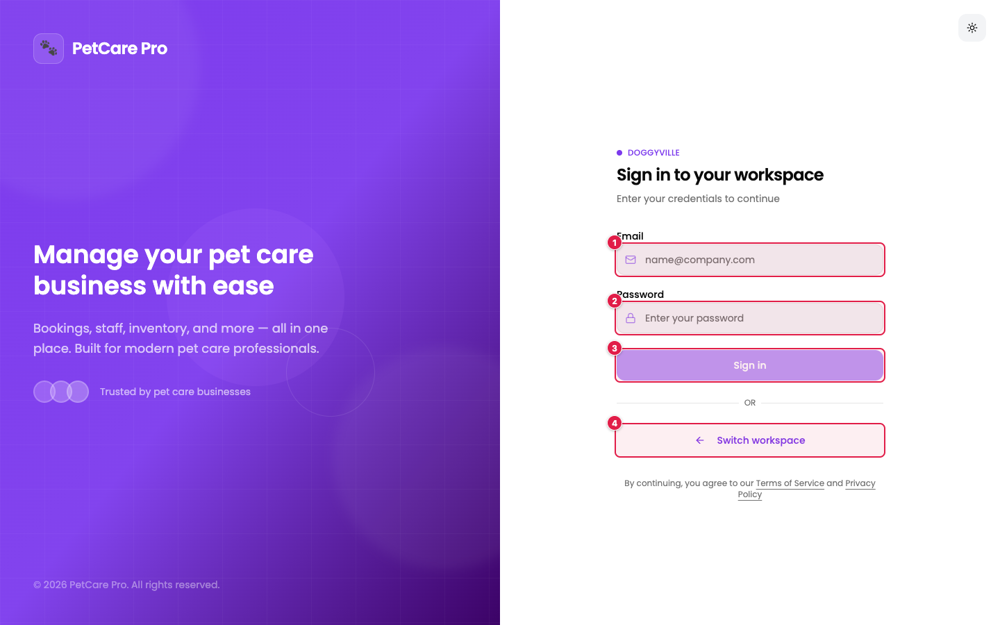
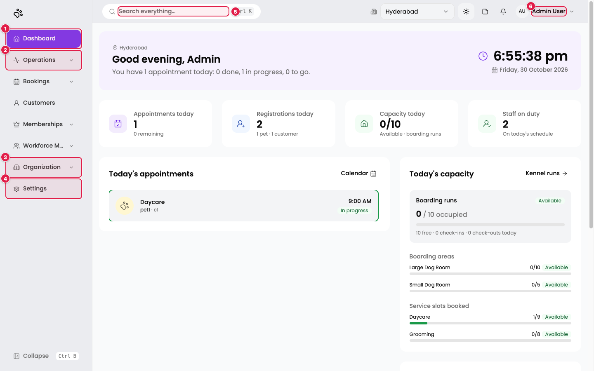
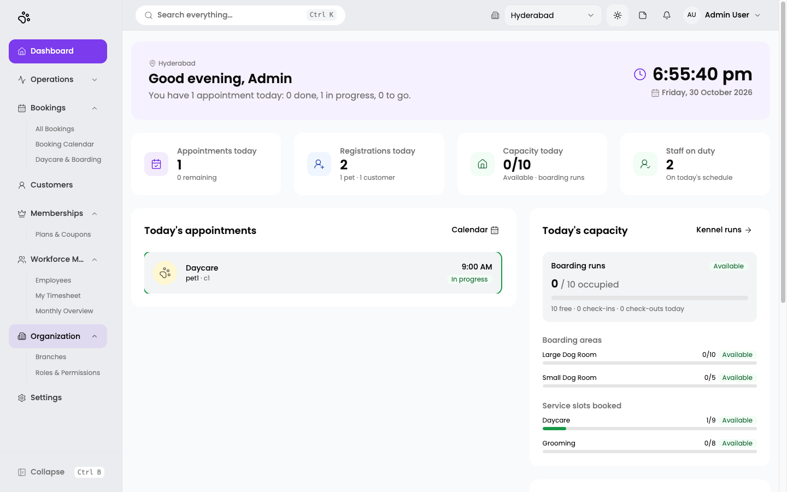

# 1. Getting started: sign in and navigation

## Sign in

Each business has its own sign-in page. DoggyVille's is `/en/t/doggyville/sign-in`.

1. **Email**: your work email address.
2. **Password**: your password.
3. **Sign in**: the button stays disabled until both fields contain text.
4. **Switch workspace**: go back to the workspace selector, where you type your business name to reach its own sign-in page.

There is no Google sign-in and no one-time-code step. Access is by email and password only. If the account has two-factor authentication enabled (an administrator can switch it on per employee, see [Employees](05-employees.md)), you are asked for a verification code after the password, or a recovery code.

## The main screen

After signing in you land on the [Dashboard](07-dashboard.md).

1. **Dashboard**: today's overview.
2. **Operations**: Services, Tasks & Activities, Task Management (only when switched on), and the Dispatch Board.
3. **Organization**: Branches and Roles & Permissions.
4. **Settings**: workspace name, country, brand colour, logo, and feature flags.
5. **Search everything**: type here, or press `Ctrl K`, to search across the app.
6. **Your account menu** (your name, top right).

The **branch selector** next to the account menu (showing *Hyderabad*) sets which branch some pages show. The Dashboard and Daycare & Boarding follow it. The Booking Calendar has its own **Branch** filter.

The **theme button** switches between light and dark. The app follows your computer's appearance setting until you change it.

## The sidebar

Click a group to expand it. The full menu is:

| Group | Entries |
|-------|---------|
| Dashboard | (single page) |
| Operations | Services · Tasks & Activities · Task Management (if switched on) · Dispatch Board |
| Bookings | All Bookings · Booking Calendar · Daycare & Boarding |
| Customers | (single page) |
| Inventory | Dashboard · Products · Categories · Suppliers · Purchase Orders · Movements (only when switched on) |
| Memberships | Plans & Coupons |
| Communication | Chat (only when switched on) |
| Reports | Overview (only when switched on) |
| Workforce Management | Employees · timesheet pages (which ones depend on your role, see [Timesheets](15-timesheets.md)) |
| Organization | Branches · Roles & Permissions |
| Settings | (single page) |

Use **Collapse** (or `Ctrl B`) at the bottom to shrink the sidebar to icons.

## What you can see depends on your role

Your role controls which pages and buttons you see. If a button such as **Add Service** is missing, your role does not include permission to create it. If a whole module is missing, either your role has no access to it or it is switched off in [Feature flags](14-settings.md#feature-flags). See [Roles & permissions](04-roles-permissions.md).
