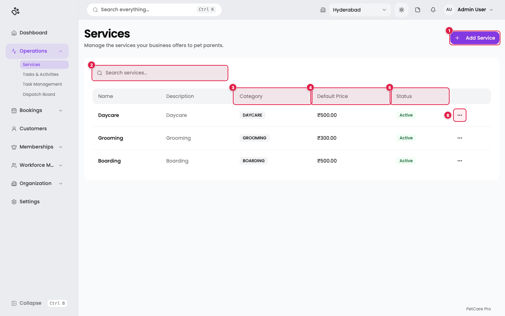
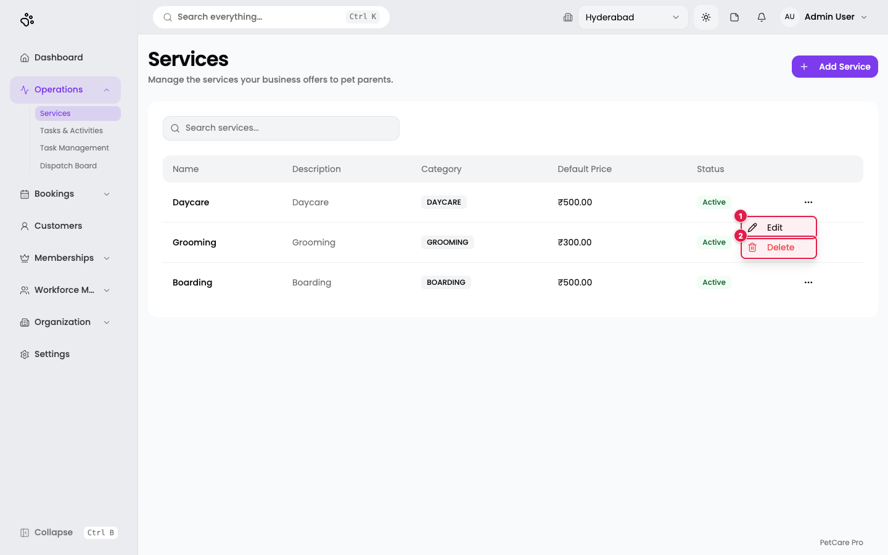
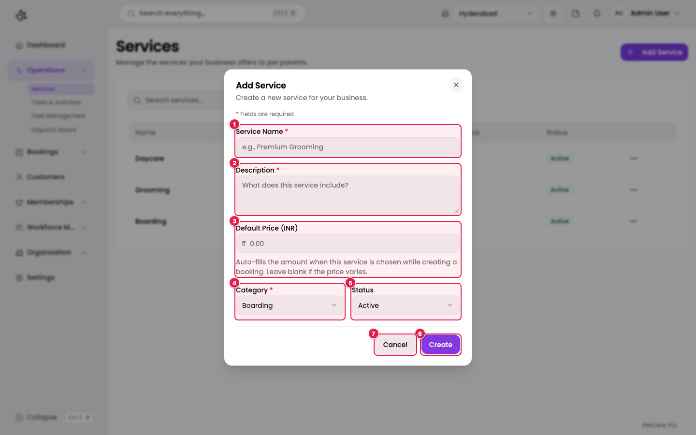
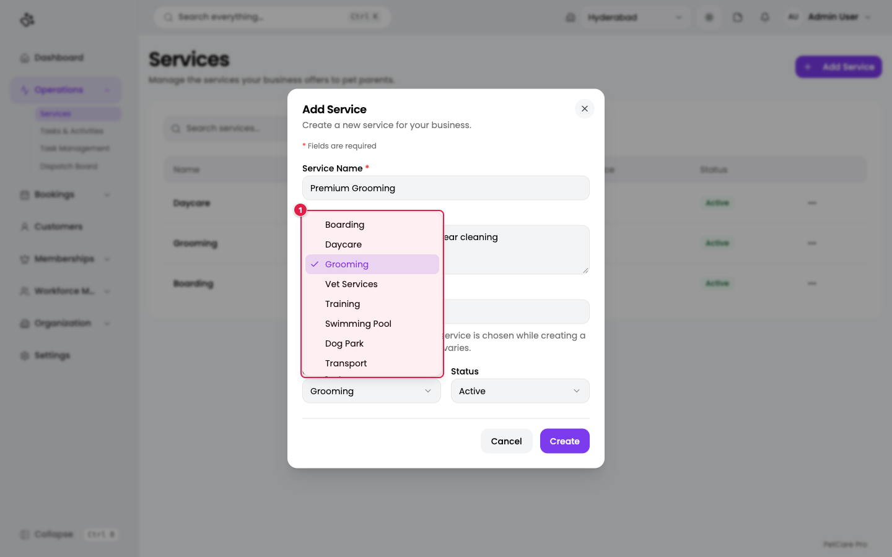
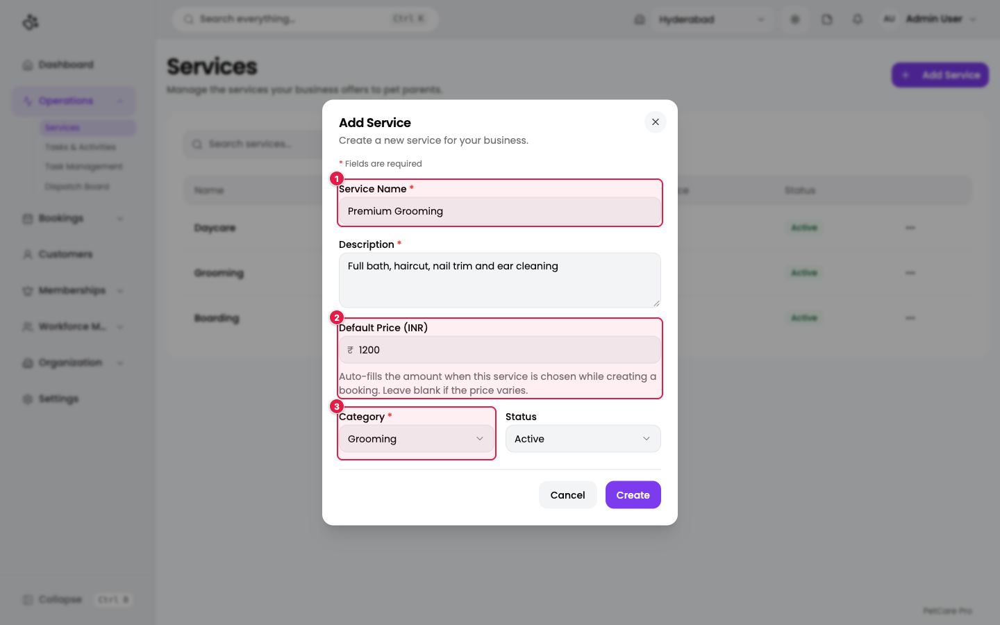
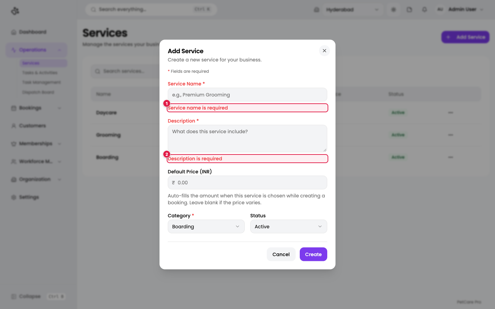
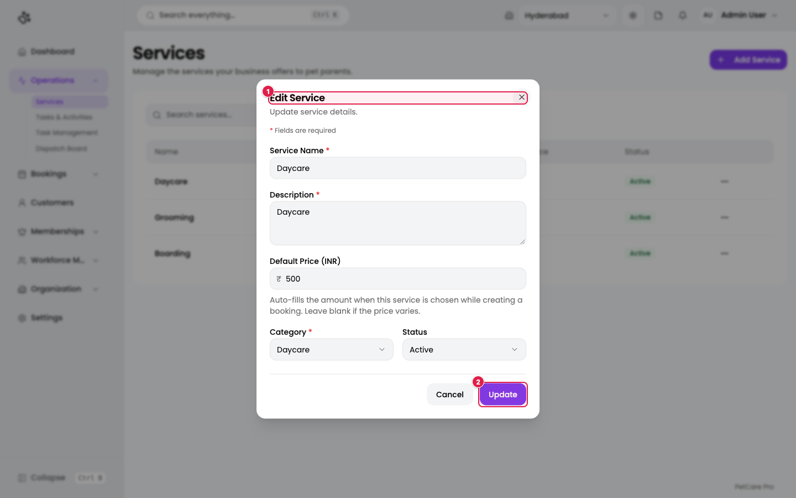
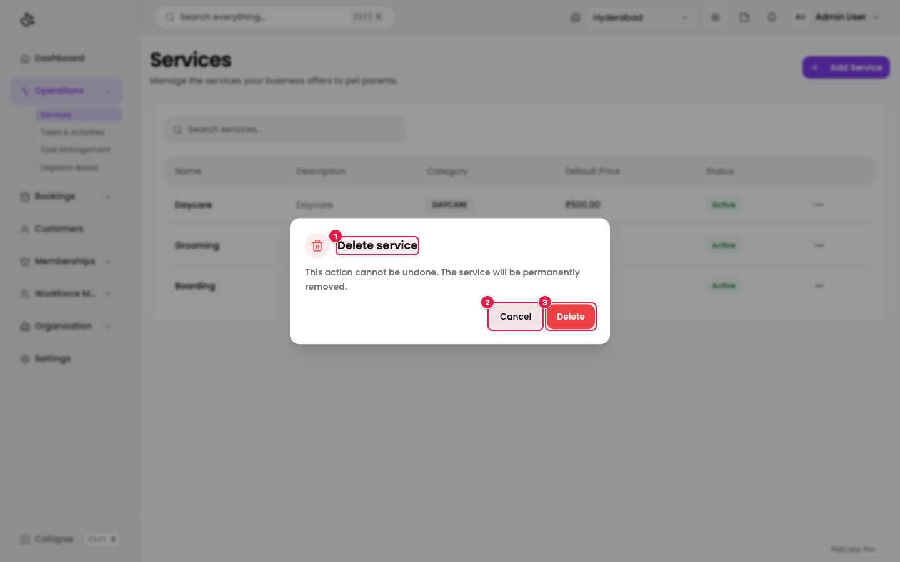

# 2. Services

**Where:** Operations → **Services** (`/en/t/doggyville/services`)

A service is something you sell: boarding, daycare, grooming, and so on. Create your services first, because [branches](03-branches.md), [employees](05-employees.md), [task templates](10-tasks-operations.md), and [bookings](09-bookings.md) all refer to them.

DoggyVille already has three services: **Daycare** (₹500), **Grooming** (₹300), and **Boarding** (₹500).

## The services list

1. **Add Service**: opens the create dialog. Hidden if your role cannot create services.
2. **Search services...**: filters the table as you type.
3. **Category**: shown as a badge (for example `DAYCARE`).
4. **Default Price**: the price in ₹, or a dash if none is set.
5. **Status**: Active or Inactive.
6. **Row menu (⋯)**: Edit and Delete for that row.

The table has these columns: Name, Description, Category, Default Price, Status.

### Row menu

1. **Edit**: opens the same form as Add Service, filled in.
2. **Delete**: asks for confirmation (see below).

## Add a service

Click **Add Service**.

| # | Field | Required | What to enter |
|---|-------|----------|---------------|
| 1 | **Service Name** | Yes | A clear customer-facing name, for example `Premium Grooming`. |
| 2 | **Description** | Yes | What the service includes. |
| 3 | **Default Price (INR)** | No | The standard price. When a booking uses this service, the amount fills in automatically. Leave blank if the price varies. Cannot be negative and cannot exceed 999,999.99. |
| 4 | **Category** | Yes | One of the eight categories below. Defaults to Boarding. |
| 5 | **Status** | No | Active (default) or Inactive. |
| 6 | **Create** | | Saves the service. |
| 7 | **Cancel** | | Closes the dialog. If you typed anything, you are asked whether to discard it. |

### Categories

The category list is: **Boarding, Daycare, Grooming, Vet Services, Training, Swimming Pool, Dog Park, Transport**. The category decides which screen opens when staff run the service later (boarding, grooming, and so on, see [Bookings](09-bookings.md#running-a-booking-service-execution)).

### A filled-in example

Here a *Premium Grooming* service is entered with a ₹1,200 default price and the Grooming category. (This was not saved.)

### Validation

If you click **Create** with required fields empty, the form shows an error under each field and does not save.

1. **Service name is required**
2. **Description is required**

When the service is saved you see a green **Service created** message and the new row appears at the top of the list.

## Edit a service

Open the row menu and choose **Edit**.

1. The title reads **Edit Service**.
2. The save button reads **Update** instead of Create.

You see **Service updated** when it saves.

## Delete a service

Open the row menu and choose **Delete**.

1. **Delete service**: the confirmation title.
2. **Cancel**: keep the service.
3. **Delete**: remove it from the list.

> **Note:** the dialog says the service "will be permanently removed". In the current build, delete only hides the service: the record is kept and flagged as deleted. If you only want to stop selling a service, set its **Status** to **Inactive** instead.

## After you create a service

A new service does nothing until you attach it to a branch. Go to [Branches](03-branches.md) and tick the service for each location that offers it. New services start with a **booking capacity of 0** at every branch until you set a number (see [Service capacity](03-branches.md#service-capacity)).
