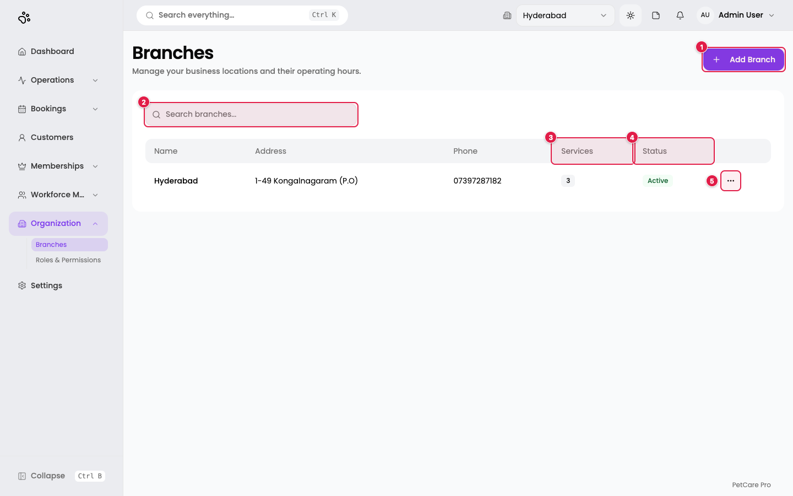
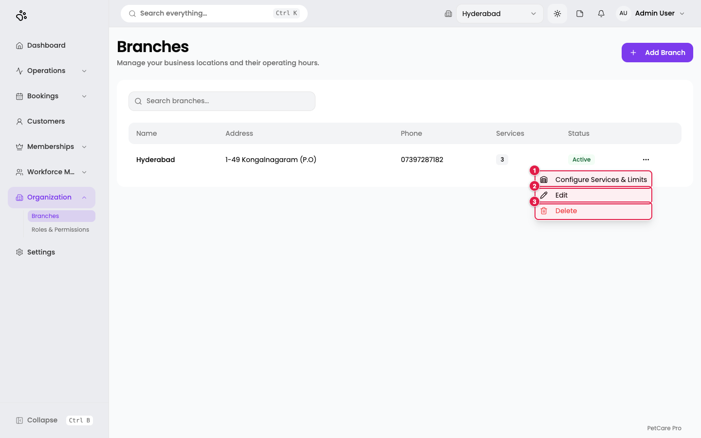
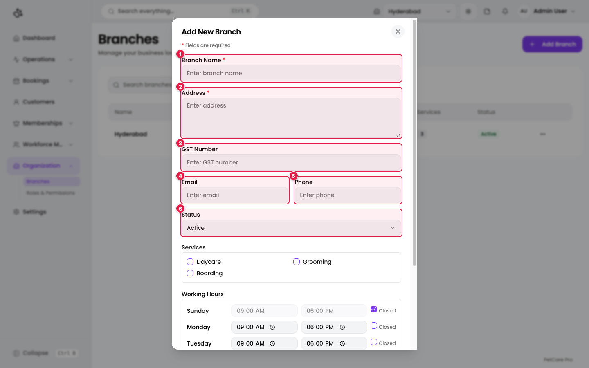
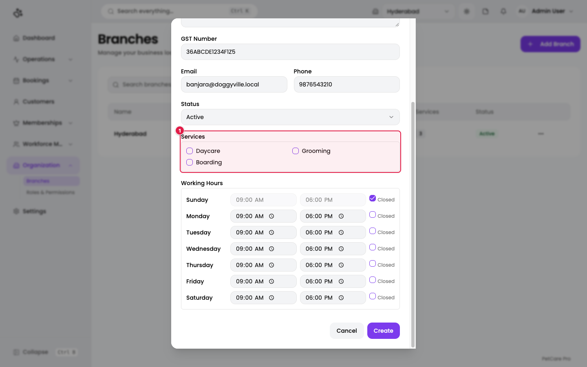
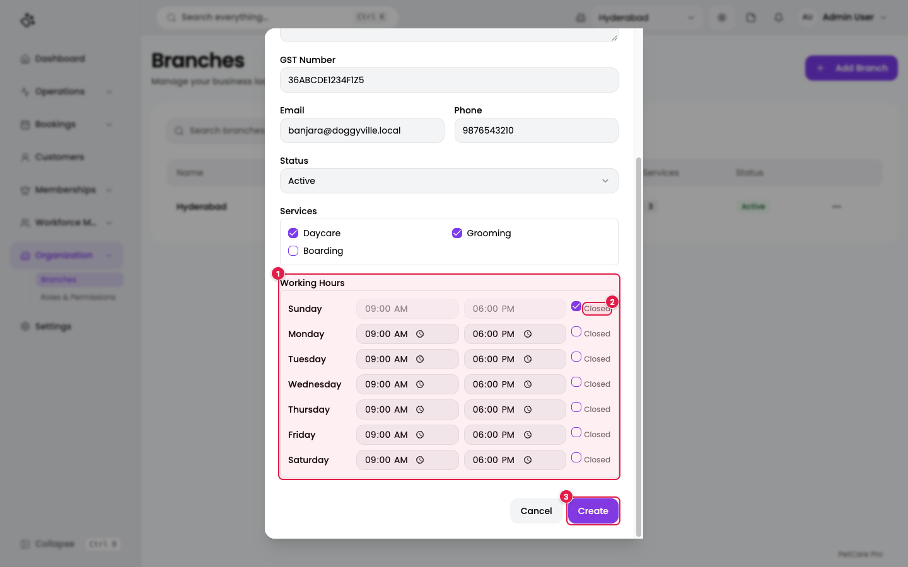
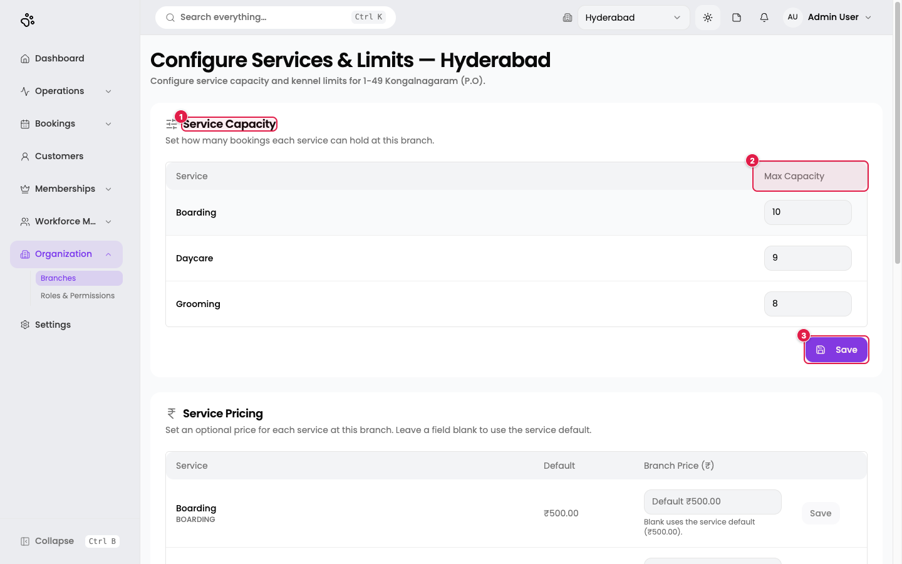
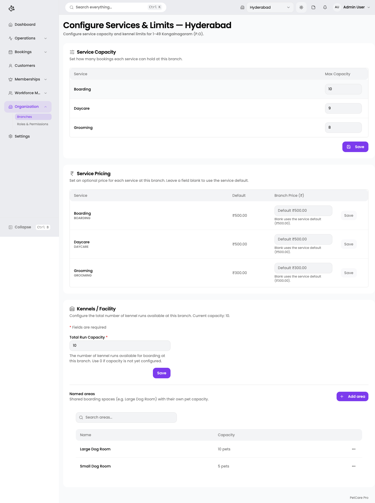

# 3. Branches

**Where:** Organization → **Branches** (`/en/t/doggyville/branches`)

A branch is one of your physical locations. This is also where you **assign services to a branch**, set opening hours, set how many bookings each service can hold, set branch-specific prices, and configure kennels.

DoggyVille has one branch, **Hyderabad**, with all three services assigned.

## The branches list

1. **Add Branch**: opens the create dialog.
2. **Search branches...**: filters the table.
3. **Services**: a badge showing how many services this branch offers.
4. **Status**: Active or Inactive.
5. **Row menu (⋯)**: Configure Services & Limits, Edit, Delete.

Columns: Name, Address, Phone, Services, Status.

1. **Configure Services & Limits**: capacity, prices, and kennels (see below).
2. **Edit**: change the branch details, services, or hours.
3. **Delete**: this **deactivates** the branch (see [Deactivating a branch](#deactivating-a-branch)).

## Add a branch

Click **Add Branch**. The dialog scrolls; the top half holds the details.

| # | Field | Required | Notes |
|---|-------|----------|-------|
| 1 | **Branch Name** | Yes | Up to 255 characters. Must be unique; a duplicate shows *"A branch with this name already exists"* under the field. |
| 2 | **Address** | Yes | Up to 500 characters. |
| 3 | **GST Number** | No | Up to 50 characters. |
| 4 | **Email** | No | Must be a valid email address if filled. |
| 5 | **Phone** | No | Free text. |
| 6 | **Status** | No | Active (default) or Inactive. |

### Assign services to the branch

Scroll down to the **Services** box. This is where a service is assigned to a branch.

1. **Services**: one tick box per service in your business. Tick every service this branch offers. If you see *"No services available"*, create your services first ([Services](02-services.md)).

You can change the assignment at any time with **Edit** on the branch row. The **Services** column in the list shows the resulting count.

### Working hours

Scroll to the bottom of the dialog.

1. **Working Hours**: one row per day, Sunday to Saturday, each with an opening time and a closing time.
2. **Closed**: tick this to mark a day as closed. The two time boxes for that day become greyed out. By default, Sunday is closed and Monday to Saturday run 09:00 to 18:00.
3. **Create**: saves the branch. The button reads **Update** when editing, and **Saving...** while it works.

The form does not check that the closing time is after the opening time, so check it yourself.

On success you see **Branch created successfully**.

### Re-using a deactivated branch name

If you create a branch with the same name as a deactivated one, the app asks **"Reactivate existing branch?"** with **Cancel** and **Reactivate** buttons. Choose Reactivate to bring the old branch back instead of making a duplicate.

## Configure services and limits

From the row menu choose **Configure Services & Limits**. This opens a page titled **Configure Services & Limits — Hyderabad** with three cards.

### Service capacity

1. **Service Capacity**: how many bookings each service can hold at this branch.
2. **Max Capacity**: one whole-number box per service. Negative numbers are changed to 0.
3. **Save**: saves all capacity values at once. You see *Service capacity saved*.

DoggyVille's current values: Boarding 10, Daycare 9, Grooming 8. A service you create later shows **0** here until you set a number, so remember to come back after adding a service. The Dashboard shows these numbers as *Service slots booked* (for example Daycare 1/9).

### Service pricing

Below capacity is **Service Pricing**: an optional price for each service at this branch.

- **Default** shows the service's standard price.
- **Branch Price (₹)**: leave it blank to use the standard price, or enter a branch-specific price. The box shows `Default ₹500.00` as a hint when blank.
- Each row has its own **Save** button, which is enabled only when you change the value. Clearing the box and saving shows *"Branch price cleared — using service default"*.

### Kennels / Facility

The **Kennels / Facility** card has:

- **Total Run Capacity** *(required)*: the number of kennel runs available for boarding. Use 0 if not yet configured. DoggyVille has 10. Save with the card's own **Save** button.
- **Named areas**: shared boarding spaces with their own pet capacity, such as *Large Dog Room* (10 pets) and *Small Dog Room* (5 pets). Use **Add area** to add one and the ⋯ menu to change it.

These numbers feed the [Daycare & Boarding](09-bookings.md#daycare--boarding-kennel-runs) grid and the Dashboard capacity card.

## Deactivating a branch

Choosing **Delete** on a branch does not erase it. A confirmation titled **Deactivate branch** says the branch will be removed from active lists and that an administrator can reverse this. Confirm with **Deactivate**.

If the branch still has active dependencies, a dialog titled **Cannot deactivate branch** lists what must be removed first and how many of each, with an **Understood** button.

## Checklist before moving on

- [ ] Branch created with address and working hours
- [ ] Every service the branch offers is ticked
- [ ] Service capacity set for each service
- [ ] Branch prices set where they differ from the default
- [ ] Total run capacity set if you offer boarding

Next: [Roles & permissions](04-roles-permissions.md), then [Employees](05-employees.md).
