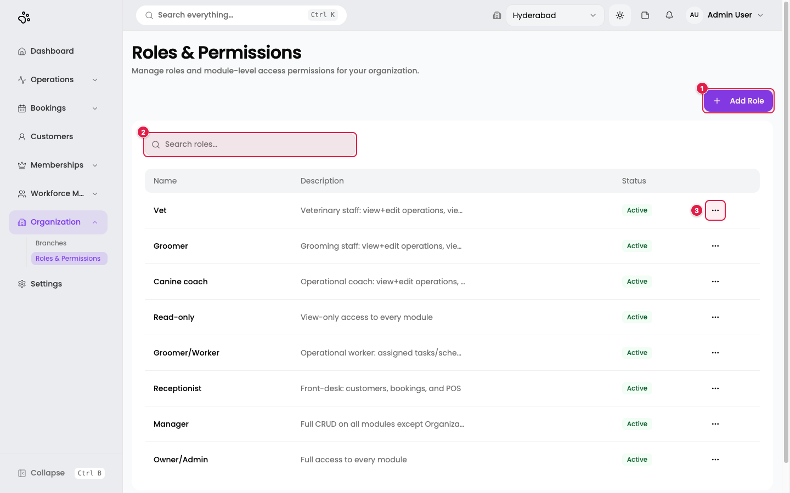
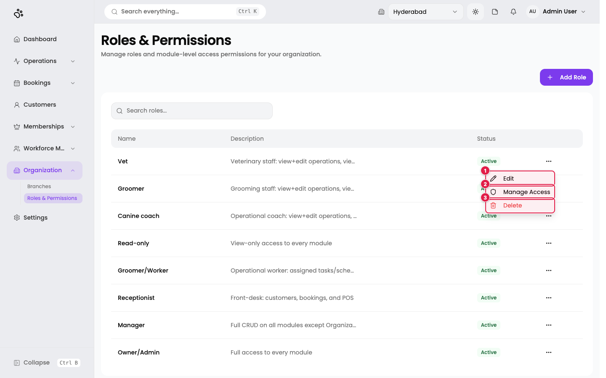
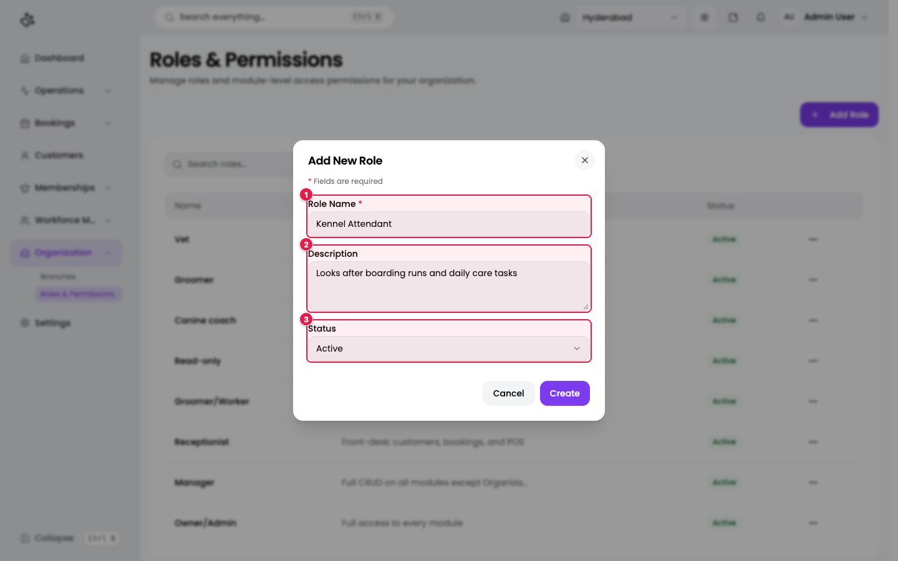
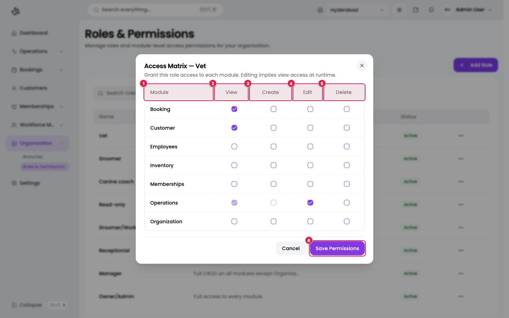

# 4. Roles & permissions

**Where:** Organization → **Roles & Permissions** (`/en/t/doggyville/roles`)

A role is a named set of permissions, such as *Receptionist* or *Groomer*. Every employee gets one or more roles **per branch** (see [Employees](05-employees.md)). What an employee can see and do in the app comes from their roles. Create or review roles before you add employees.

> Only people whose role allows **editing the Organization module** can open this page. Others are sent back to the Dashboard.

## The roles list

1. **Add Role**: create a new role.
2. **Search roles...**: filter the table.
3. **Row menu (⋯)**: Edit, Manage Access, Delete.

Columns: Name, Description, Status.

DoggyVille has eight roles: **Vet, Groomer, Canine coach, Read-only, Groomer/Worker, Receptionist, Manager, Owner/Admin**. Their descriptions summarise what they allow, for example *Owner/Admin: Full access to every module* and *Receptionist: Front-desk: customers, bookings, and POS*.

1. **Edit**: change name, description, or status.
2. **Manage Access**: open the access matrix (below).
3. **Delete**: remove the role. A role that is still assigned to employees cannot be removed; the page shows the reason.

## Add a role

Click **Add Role**.

| # | Field | Required | Notes |
|---|-------|----------|-------|
| 1 | **Role Name** | Yes | For example `Kennel Attendant`. |
| 2 | **Description** | No | Tell others what the role is for. |
| 3 | **Status** | No | Active (default) or Inactive. Only active roles can be assigned to employees. |

Click **Create**. You see *Role created successfully*. The new role has **no access to anything** until you set its access matrix.

## Set what a role can do: the access matrix

Open the row menu and choose **Manage Access**.

1. **Module**: the seven areas of the product: **Booking, Customer, Employees, Inventory, Memberships, Operations, Organization**.
2. **View**: see the module's pages and records.
3. **Create**: add new records.
4. **Edit**: change existing records.
5. **Delete**: remove records.
6. **Save Permissions**: apply the changes. You see *Module access updated*.

How the ticks behave:

- Permissions work as a ladder. Ticking a higher permission automatically ticks the lower ones it needs. For example, ticking **Edit** also ticks **View**.
- A tick that a higher level depends on is greyed out. Hover over it to read *"Required by a higher access level and cannot be unchecked."*
- In the screenshot, the Vet role can view Bookings and Customers, and edit Operations (which includes viewing it).

An employee with several roles gets the **union** of all their roles' permissions.

## Which module covers which pages?

| Module | Pages it controls | Level needed to open the page |
|--------|-------------------|-------------------------------|
| Operations | Services, Tasks & Activities, Task Management, Dispatch Board | View |
| Booking | All Bookings, Booking Calendar | View |
| Customer | Customers and pets, and Communication (Chat) | View |
| Employees | Employees, schedules, assignments | View |
| Inventory | All Inventory pages (when switched on) | View |
| Memberships | Plans & Coupons | View |
| Organization | Branches | View |
| Organization | Roles & Permissions, Settings | **Edit** |
| (varies) | Each Reports category uses the module it reports on | View |

This table comes from the access check at the top of each page in the application. It did not cover Daycare & Boarding, Employees' timesheet pages, or the booking wizard, so those are not listed.

Buttons inside a page are gated separately: for example **Add Service** needs *Create* on Operations, and **Edit** or **Delete** in a row menu need *Edit* or *Delete*.

## Tips

- Start from the closest default role and adjust it, rather than building from zero.
- Give the **Read-only** role to people who only need to look.
- Keep **Organization → Edit** to owners and trusted managers: it controls branches, roles, and settings.
- Roles are set up **per branch** on each employee. The same person can be a Manager in one branch and a Receptionist in another.

Next: [Employees](05-employees.md).
