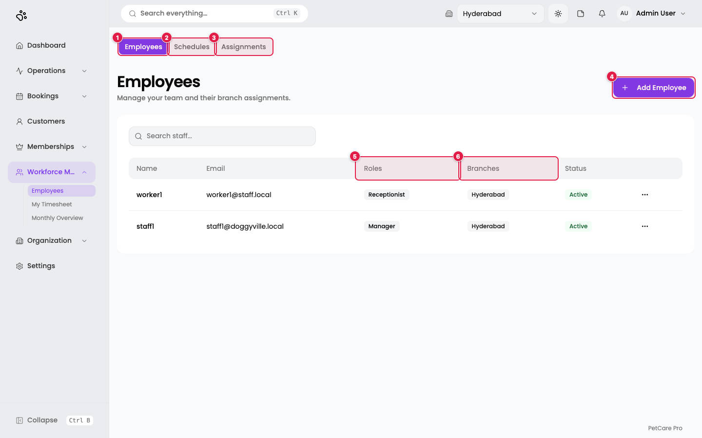
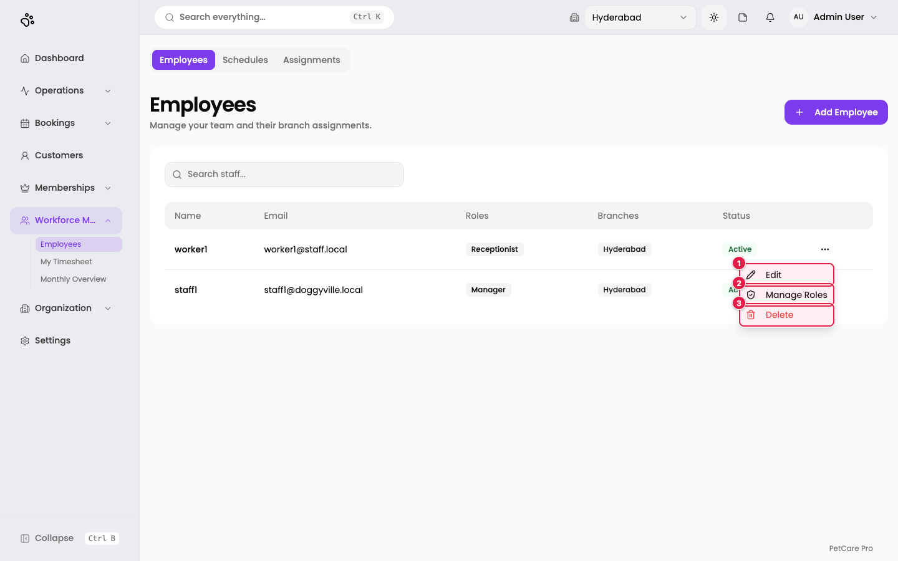
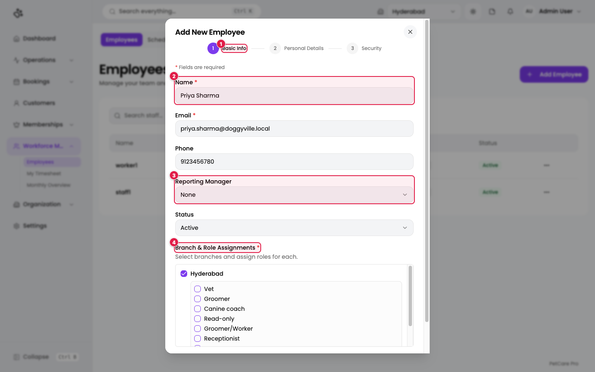
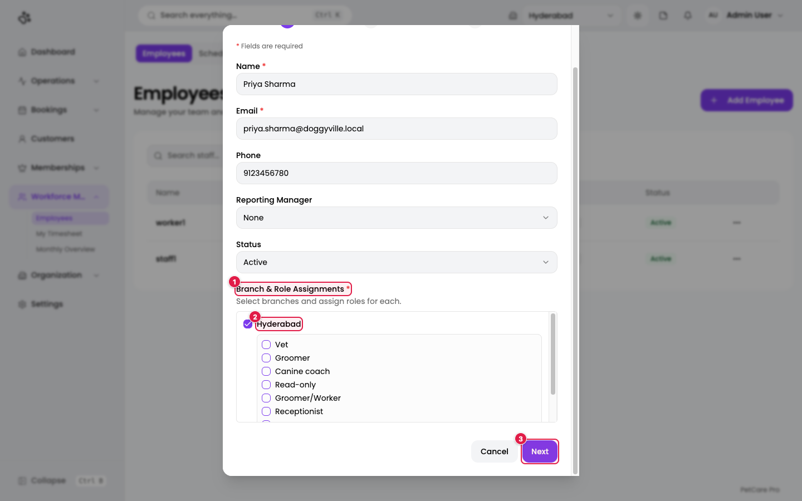
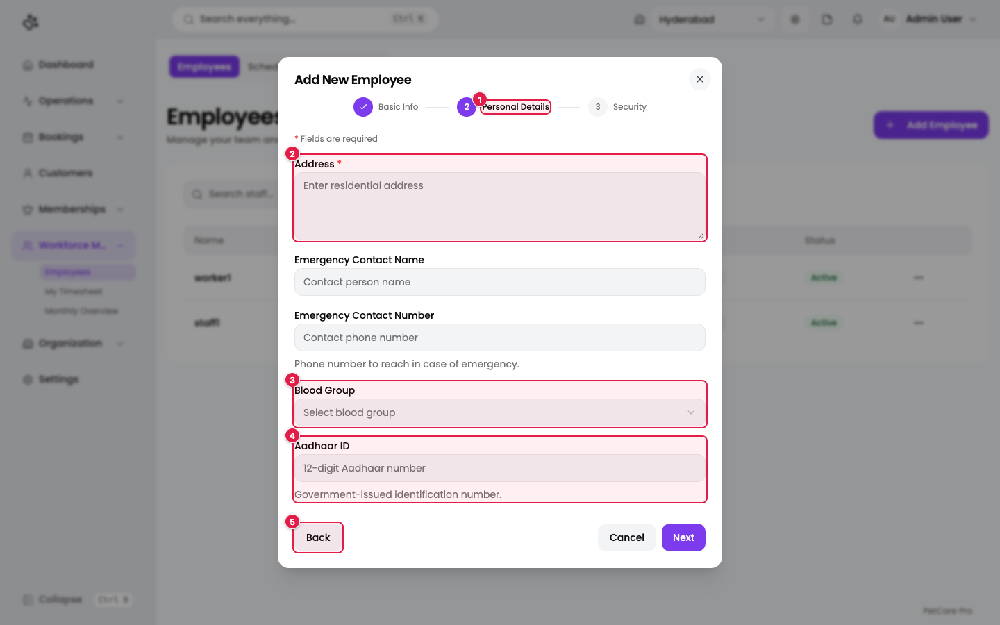
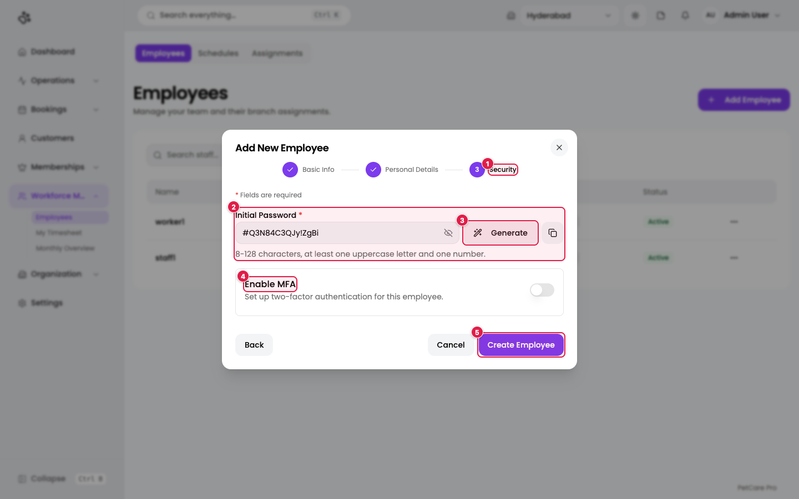
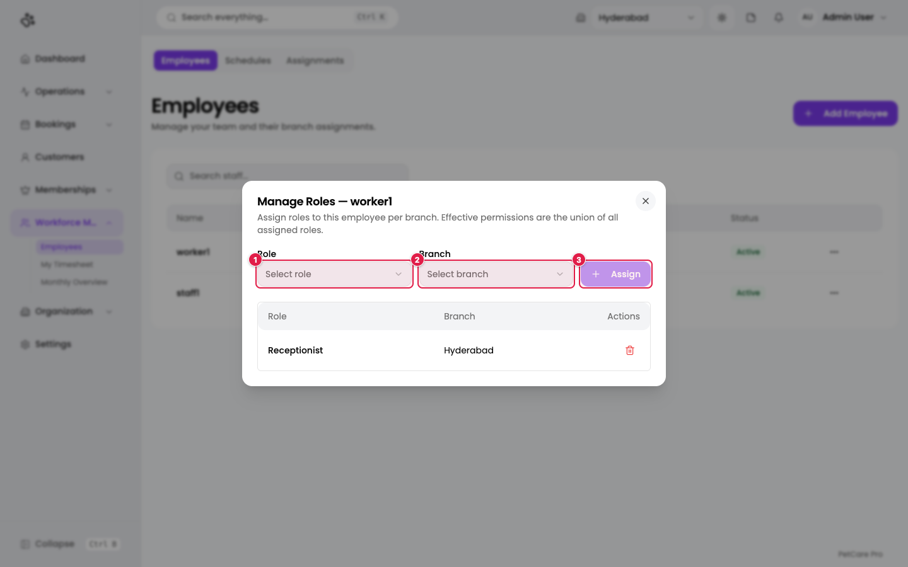
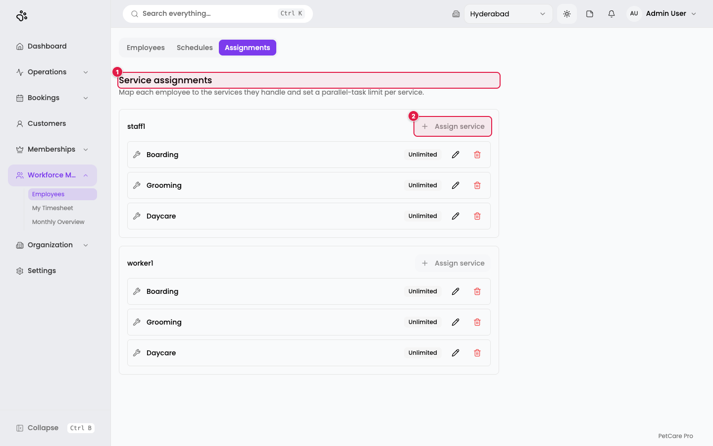
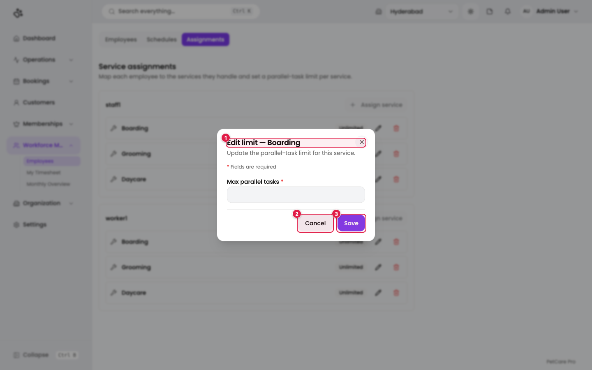

# 5. Employees

**Where:** Workforce Management → **Employees** (`/en/t/doggyville/staff`)

This page manages your team: who they are, which branches they work in, which roles they hold, and which services they handle. It has three tabs: **Employees**, **Schedules** (see [Schedules](06-schedules.md)), and **Assignments**.

Before you add an employee you need at least one [branch](03-branches.md) and one [role](04-roles-permissions.md).

## The Employees tab

1. **Employees** tab: the list you are on.
2. **Schedules** tab: shifts and weekly templates.
3. **Assignments** tab: which services each employee handles.
4. **Add Employee**: opens the three-step wizard.
5. **Roles**: every role the person holds.
6. **Branches**: every branch they work in.

Columns: Name, Email, Roles, Branches, Status. There is also a search box (*Search staff...*).

### Row menu

1. **Edit**: change details; the same wizard opens, filled in.
2. **Manage Roles**: add or remove role-per-branch assignments.
3. **Delete**: asks you to confirm and removes the employee from all branches and roles.

## Add an employee: the three-step wizard

Click **Add Employee**. The step bar at the top shows **1 Basic Info → 2 Personal Details → 3 Security**. Completed steps show a tick. **Next** checks the current step before moving on.

### Step 1: Basic Info

1. **Basic Info**: the current step.
2. **Name** *(required)*.
3. **Reporting Manager**: choose another employee, or leave as *None*. Used for the timesheet approval chain.
4. **Branch & Role Assignments** *(required)*.

The other fields on this step are **Email** *(required, must be valid)*, **Phone**, and **Status** (Active or Inactive).

#### Assign branches and roles

1. **Branch & Role Assignments**: tick every branch this person works at.
2. **Branch tick box** (here, *Hyderabad*): when ticked, the list of all active roles opens underneath. Tick the roles this person holds **at that branch**.
3. **Next**: moves to step 2.

You must tick at least one branch and at least one role. Un-ticking a branch removes the roles you picked for it.

### Step 2: Personal Details

1. **Personal Details**: the current step.
2. **Address** *(required, up to 500 characters)*.
3. **Blood Group**: A+, A-, B+, B-, AB+, AB-, O+, or O-.
4. **Aadhaar ID**: the 12-digit government ID. The field only needs text; the format is not checked.
5. **Back**: return to step 1.

Also on this step: **Emergency Contact Name** and **Emergency Contact Number** (both optional). Step 2 appears only when creating a new employee.

### Step 3: Security

1. **Security**: the current step.
2. **Initial Password** *(required)*: 8 to 128 characters, with at least one capital letter and one number. Use the eye icon to show or hide it, and the copy icon to copy it.
3. **Generate**: fills in a strong random password.
4. **Enable MFA**: switch on two-factor authentication for this employee. They set it up when they first sign in. Off by default, and available only when creating.
5. **Create Employee**: saves. The button is disabled until a branch is ticked.

After saving, a dialog shows the password (and the MFA setup details if MFA was enabled). **Copy it now** and pass it to the employee through a secure channel; you cannot read it again later.

> While editing an existing employee, the password box reads **New Password** and may be left blank to keep the current one. Entering a new password resets it and signs the employee out everywhere.

## Manage roles after creation

Open the row menu and choose **Manage Roles**.

1. **Role**: pick from active roles.
2. **Branch**: pick from active branches.
3. **Assign**: adds the pair. The table below lists every role-at-branch assignment, each with a bin icon to remove it.

Here *worker1* is a **Receptionist** at **Hyderabad**. An employee can hold the same role at several branches, but the same role–branch pair can only be added once.

## The Assignments tab: map employees to services

**Where:** Workforce Management → Employees → **Assignments**

This tab tells the app which services each employee can work on, and how many tasks of that service they can do at the same time. The Dispatch Board uses it to decide who can take a task ([Tasks & operations](10-tasks-operations.md)).

1. **Service assignments**: the tab heading.
2. **Assign service**: one button per employee. It is greyed out when that employee already has every active service.

Each row shows a service name, a badge (*Unlimited* or *N parallel*), an edit (pencil) icon, and a remove (bin) icon.

### Assign a service

Click **Assign service** on an employee card. This opens a dialog with:

- **Service** *(required)*: only services not yet mapped to this person appear.
- **Max parallel tasks** *(required)*: a whole number from 1 to 999. Default 1. It is how many tasks of this service the employee can carry at once before showing as busy for it.

Click **Assign**. You see *Service assigned*.

> The screenshot for this dialog could not be captured because both existing employees already have all three services, which disables the button. The fields above are taken from the application's code.

### Edit or remove a limit

1. **Edit limit — Boarding**: the dialog title names the service.
2. **Cancel**: close without changes.
3. **Save**: store the new limit. You see *Limit updated*.

The pencil icon opens this dialog. The bin icon removes the service from the employee, after a confirmation (*"They will no longer be assignable to tasks for this service"*).

## Checklist before moving on

- [ ] Every employee has at least one branch and one role
- [ ] Reporting managers are set where timesheets need approval
- [ ] Each employee is mapped to the services they can work on
- [ ] Passwords have been handed over securely

Next: [Schedules](06-schedules.md).
