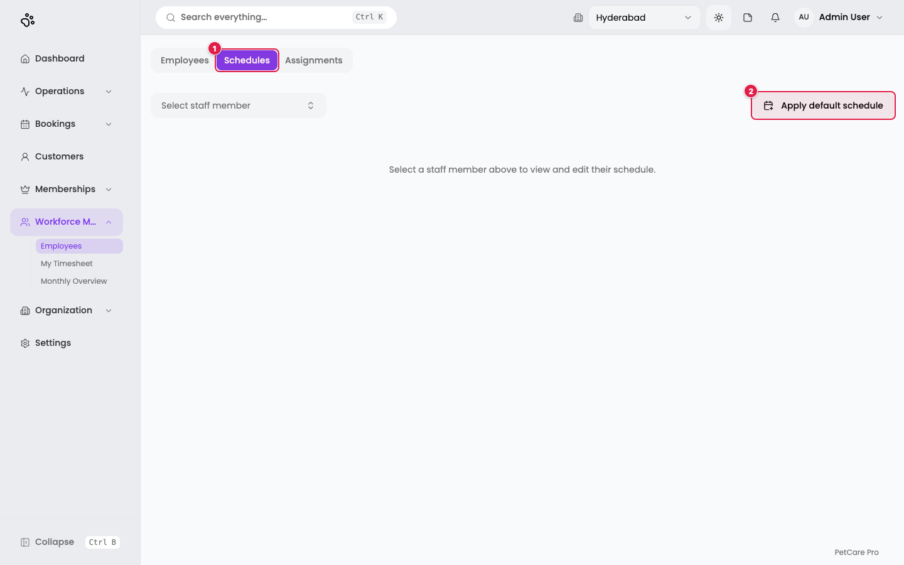
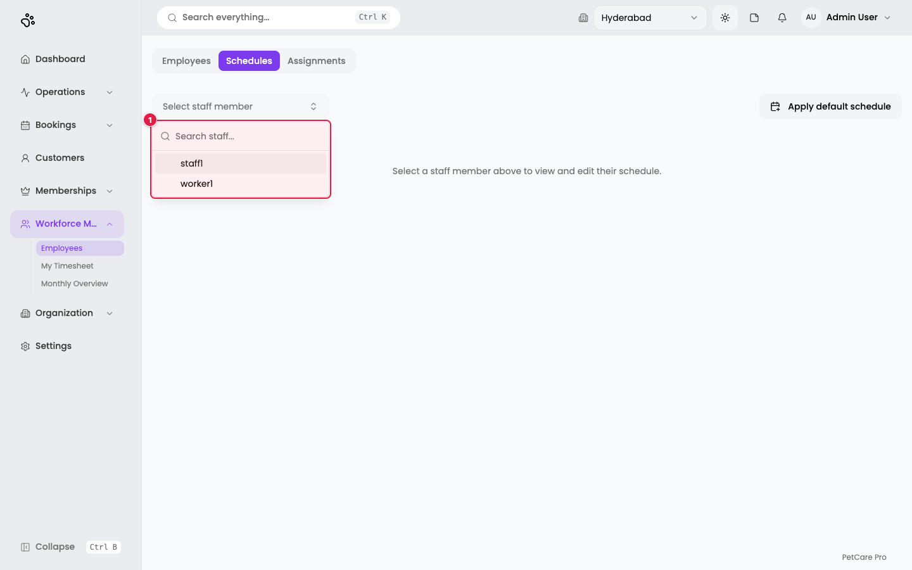
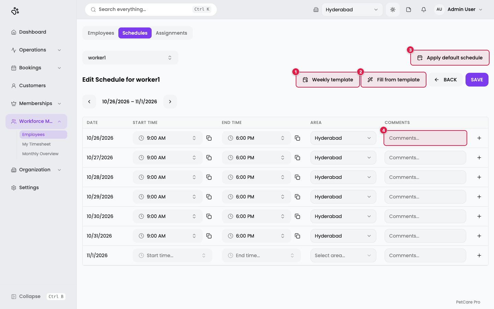
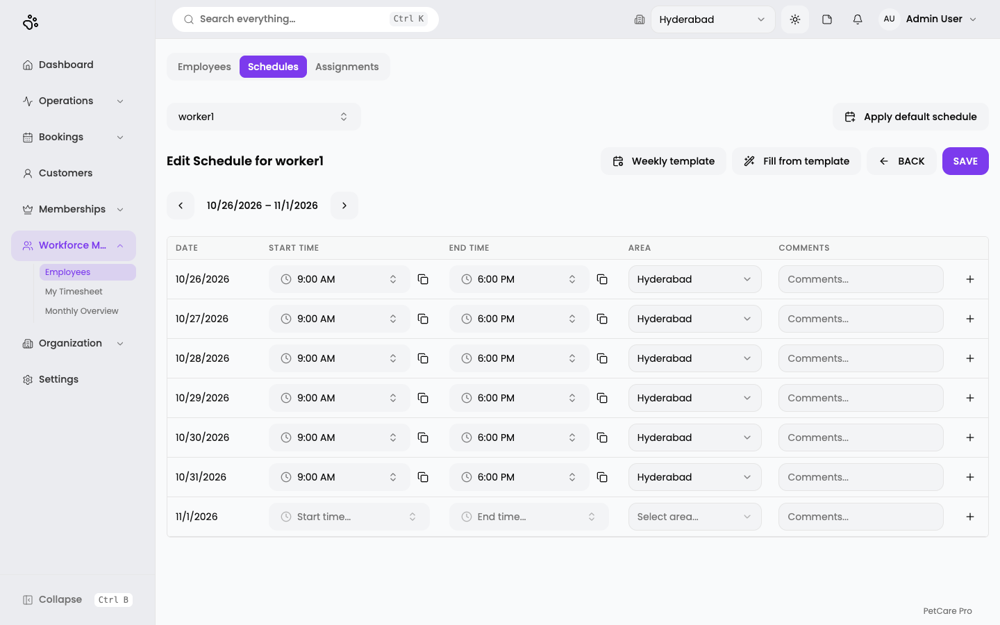
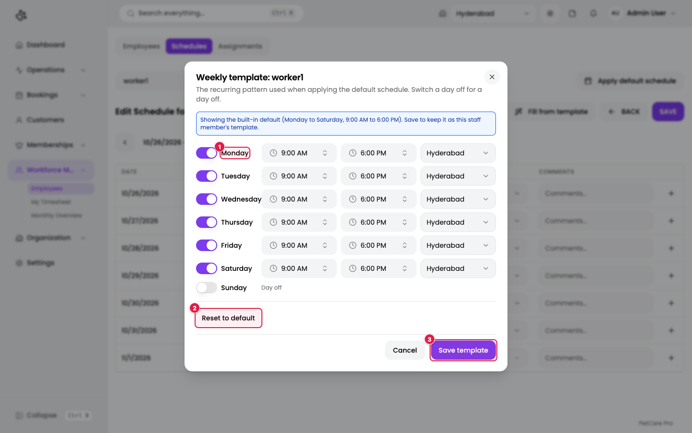
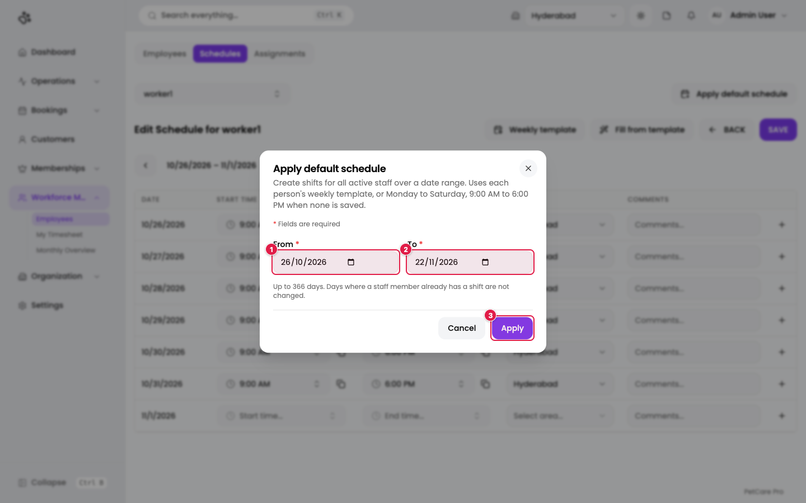

# 6. Schedules

**Where:** Workforce Management → Employees → **Schedules** tab (`/en/t/doggyville/staff?tab=schedules`)

Schedules record **who works where and when**. Each shift has a date, a start time, an end time, and a branch. The Dashboard's *Staff on duty* tile and its *Staffs on duty* card (each person's name, role, and in and out times) show today's shifts.

Admins and managers can edit schedules. Employees with the plain *user* sign-in role can only look at theirs.

## Open the Schedules tab

1. **Schedules** tab.
2. **Apply default schedule**: create shifts for all active staff over a date range (see below). Hidden for read-only users.

Until you choose someone, the page says *"Select a staff member above to view and edit their schedule."*

## Pick an employee

Click **Select staff member**. A list opens with a search box.

1. The list shows active employees. Type to search. Pick one to load their week.

## The weekly editor

1. **Weekly template**: opens the recurring pattern for this person (below).
2. **Fill from template**: fills the days that have no shift yet using the template. The rows are **not saved** until you press **SAVE**.
3. **Apply default schedule**: the same bulk tool described below.
4. **Comments...**: an optional note on a shift (up to 255 characters).

Other controls:

- The **◀ ▶ arrows** with the date range (here 10/26/2026 – 11/1/2026) move one week at a time.
- **BACK** leaves the editor. If you have unsaved changes it asks *"Discard Changes?"* with **Discard** and **Keep Editing**.
- **SAVE** stores the week. You see *Schedule saved successfully*.

### Reading a row

Each row is one shift:

| Column | What it does |
|--------|--------------|
| **Date** | The day. Only the first shift of a day shows the date. |
| **Start time** / **End time** | Pick times from the drop-downs. The small copy icon beside each time copies it so you can paste it into another row. |
| **Area** | The branch where the person works that shift. |
| **Comments** | Optional note. |
| **+** | Add another shift on the same day. |

Rules the editor enforces:

- At most **3 shifts per day**. Past that, the **+** tooltip reads *"Maximum 3 shifts per day."*
- The **end time must be after the start time**.
- Entering one of start or end time requires the other.
- A shift with times needs a **branch**.

If a rule is broken, **SAVE** shows a message such as *"Invalid entry on 2026-10-26: End time must be after start time"* and nothing is saved.

In this view worker1 works 9:00 AM to 6:00 PM at Hyderabad from Monday to Saturday, with Sunday empty.

## Weekly template

Click **Weekly template** to set a person's usual week. The "default schedule" and **Fill from template** both use it.

1. **Day row** (here Monday): the switch turns a working day on or off. Each working day has a start time, an end time, and a branch.
2. **Reset to default**: go back to Monday to Saturday, 9:00 AM to 6:00 PM, with Sunday as a day off.
3. **Save template**: stores it. You see *Weekly template saved*.

The blue note at the top says when you are looking at the built-in default rather than a saved template. If the person has no single home branch, you must pick a branch for each working day.

## Apply a default schedule to everyone

Click **Apply default schedule** (on the Schedules tab or inside the editor).

1. **From** *(required)*: first date.
2. **To** *(required)*: last date. The range is up to 366 days, and starts as this week plus four weeks.
3. **Apply**: creates shifts for **all active staff** using each person's weekly template, or Monday to Saturday 9:00 AM to 6:00 PM if they have none.

Days where someone **already has a shift are not changed**, so it is safe to run again. When it finishes, a summary says how many shifts were created for how many people, and lists anyone who could not be scheduled with the reason (for example, no branch to default to), with a **Done** button.

## There is no separate leave screen here

Leave is marked from the team timesheet, not the schedule. See [Timesheets](15-timesheets.md).

## Checklist

- [ ] A weekly template exists for every employee whose week differs from Monday–Saturday 9 to 6
- [ ] **Apply default schedule** has run for the weeks ahead
- [ ] Spot-check a few people in the weekly editor

Next: the day-to-day chapters, starting with the [Dashboard](07-dashboard.md).
