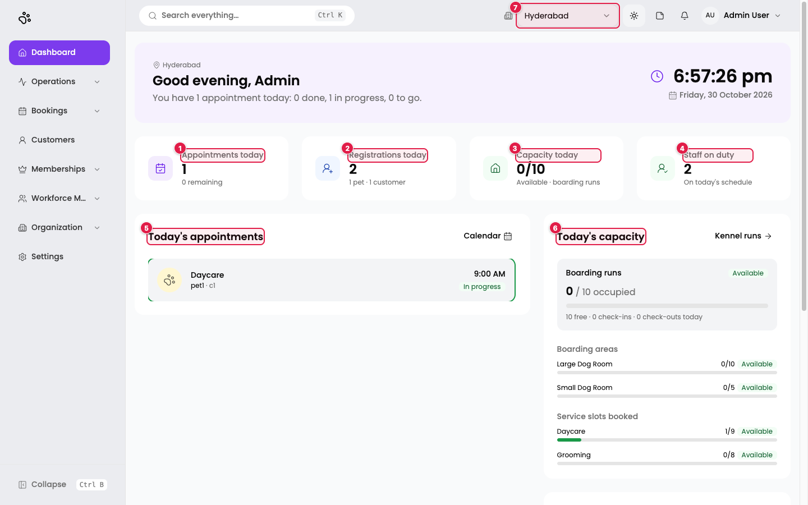
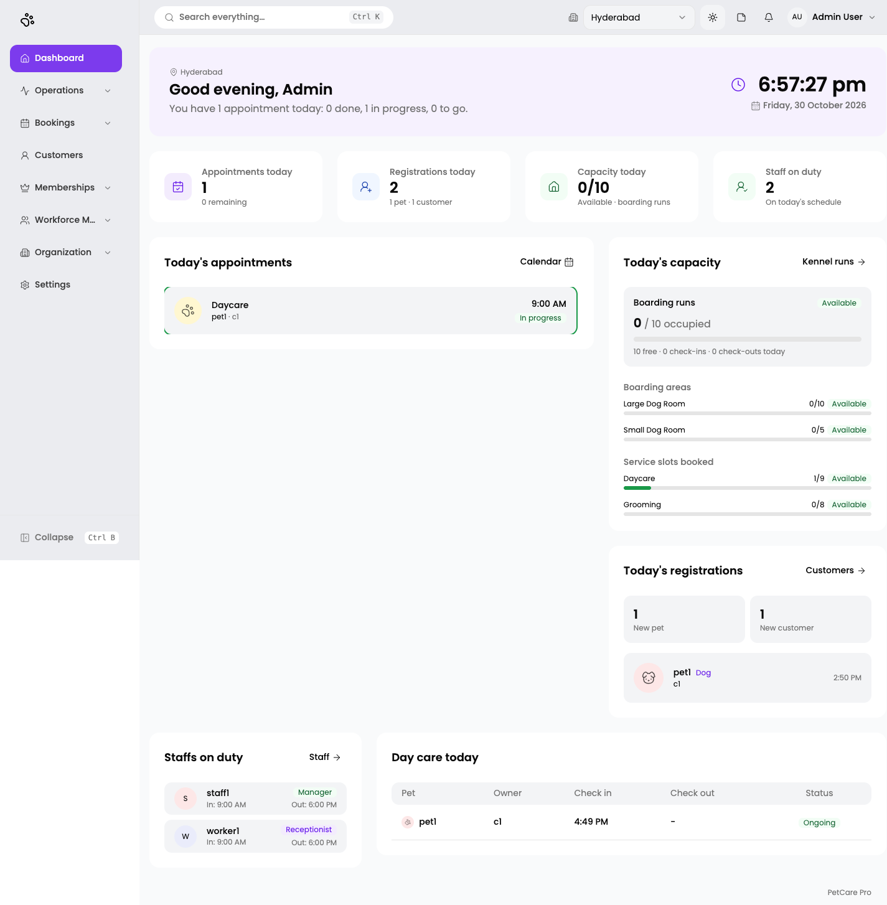

# 7. Dashboard

**Where:** **Dashboard** (`/en/t/doggyville`)

The Dashboard is your start-of-day view for the **branch selected at the top of the screen**. It refreshes every time you open it.

1. **Appointments today**: how many bookings are scheduled today, with how many remain. Click to open [All Bookings](09-bookings.md).
2. **Registrations today**: new customers and pets added today (here *1 pet · 1 customer*). Click to open [Customers](08-customers-pets.md).
3. **Capacity today**: boarding runs in use out of the branch total (here *0/10*), with the label *Available*, *Filling up*, or *Full*. Click to open [Daycare & Boarding](09-bookings.md#daycare--boarding-kennel-runs). If the branch has no run capacity set, it reads *Run capacity not set*; if no branch is selected, *Select a branch*.
4. **Staff on duty**: how many people have a shift today ([Schedules](06-schedules.md)). Click to open [Employees](05-employees.md).
5. **Today's appointments**: the day's bookings in time order, each with a status pill (*Done*, *In progress*, *Due*, or *Upcoming*). The next one is highlighted. **Calendar** at the top right opens the [Booking Calendar](09-bookings.md#booking-calendar).
6. **Today's capacity**: boarding runs with a bar, named boarding areas (for example *Large Dog Room 0/10*), and *Service slots booked* per service (for example *Daycare 1/9*). **Kennel runs** opens the occupancy grid.
7. **Branch selector**: change the branch; the whole Dashboard follows.

The greeting at the top changes by time of day (*Good morning*, *Good afternoon*, *Good evening*) and shows a live clock with a one-line summary such as *"You have 1 appointment today: 0 done, 1 in progress, 0 to go."*

## Full page

Scroll down for the remaining cards:

- **Today's registrations:** a count of new pets and new customers, then each new pet with its species and the time it was added.
- **Day care today:** a table of *Pet, Owner, Check in, Check out, Status*. Status is *Ongoing*, *Finished*, *Upcoming*, or *Cancelled*.
- **Staffs on duty:** each person with their role and today's shift. Here *staff1* (Manager) and *worker1* (Receptionist) are both in at 9:00 AM and out at 6:00 PM. These come from the [schedules](06-schedules.md).

## If the Dashboard looks empty

- **No branch yet:** a banner links you to [Branches](03-branches.md).
- **No staff on duty:** shifts have not been set up ([Schedules](06-schedules.md)).
- **Capacity shows "not set":** set **Total Run Capacity** on the branch ([Branches](03-branches.md#kennels--facility)).
- If the page cannot load, you see *"We couldn't load your dashboard right now. Please refresh to try again."*
