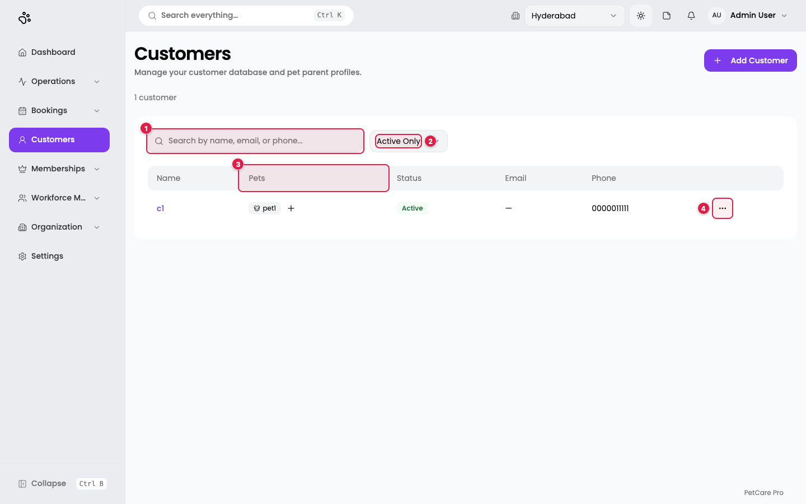
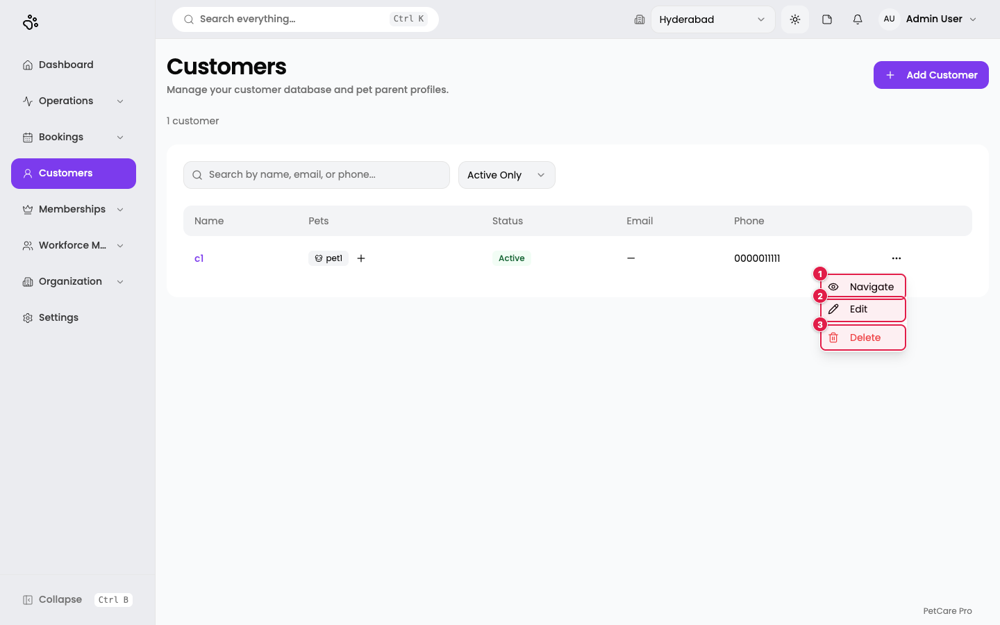
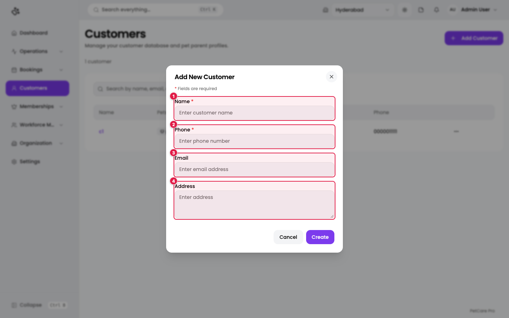
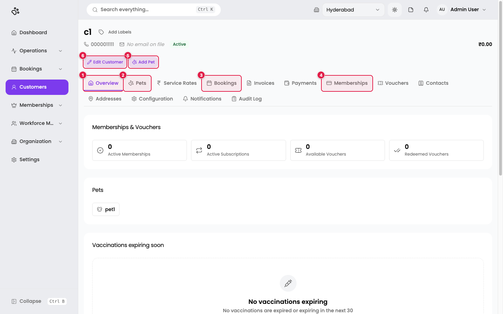
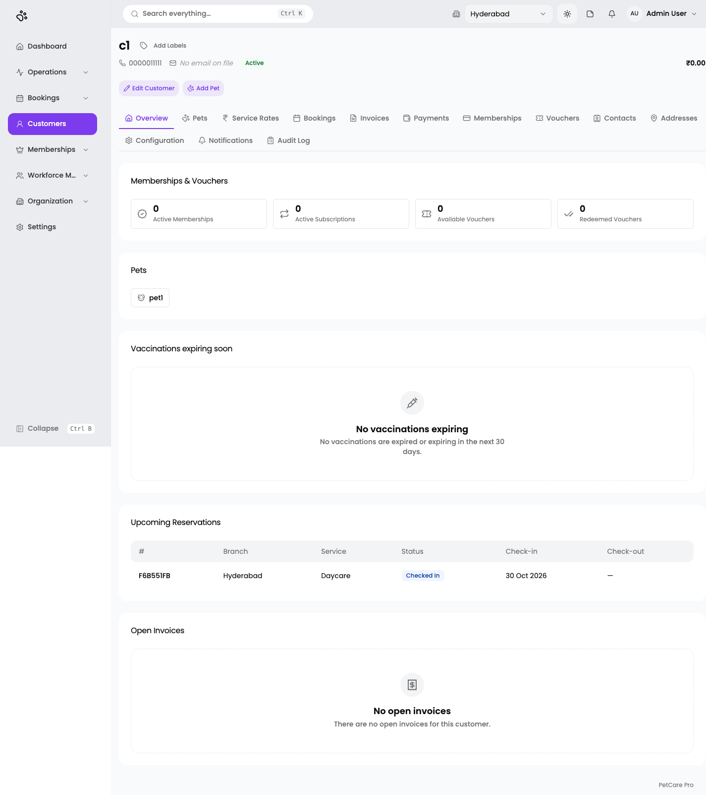
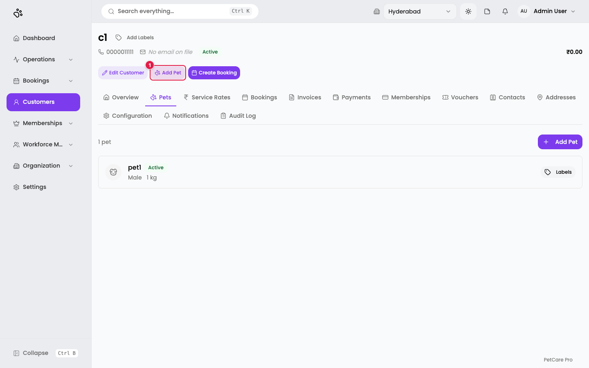
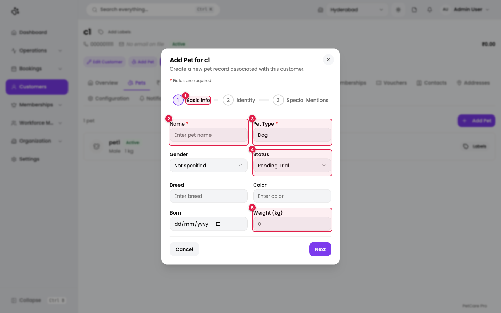
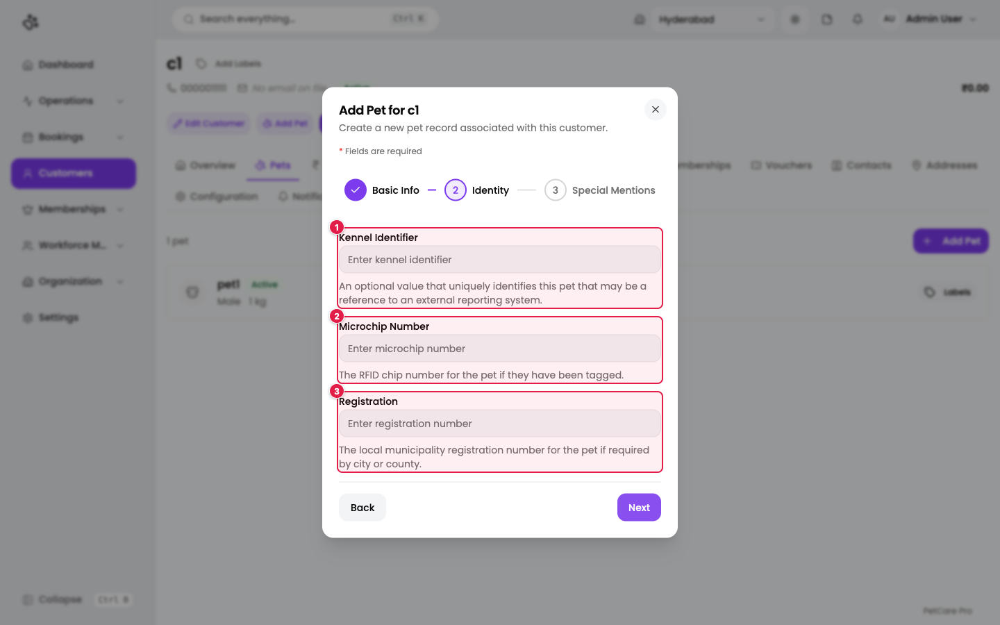
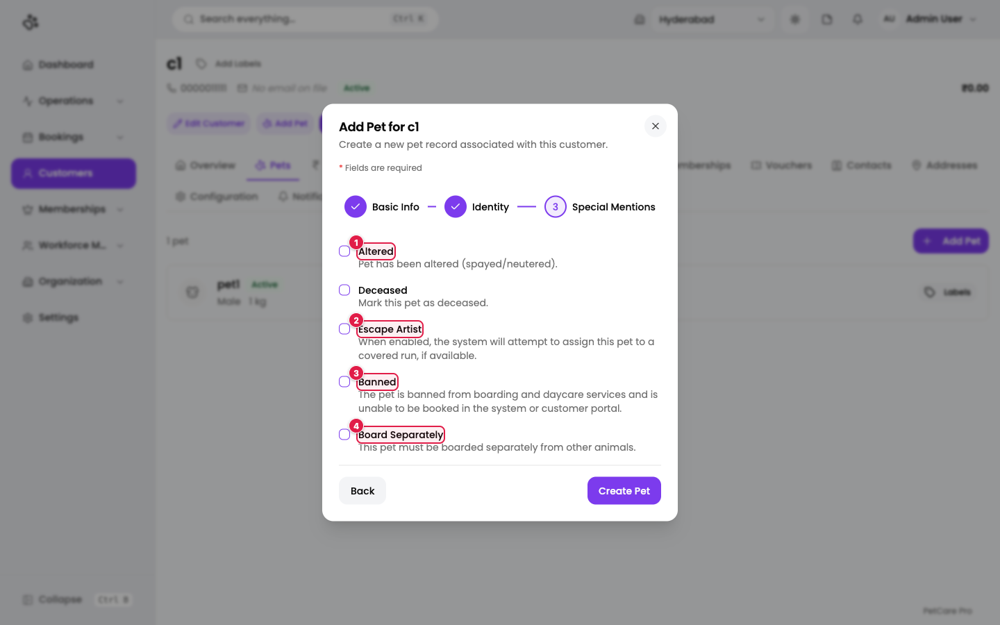

# 8. Customers & pets

**Where:** **Customers** (`/en/t/doggyville/customers`)

A customer is a pet parent. Pets belong to a customer, so create the customer first. Bookings need both.

## The customers list

1. **Search by name, email, or phone...**
2. **Active Only / Show All**: a filter on status. The list starts on *Active Only*.
3. **Pets**: the customer's pets as small tags. The **+** beside them adds another pet.
4. **Row menu (⋯)**: Navigate, Edit, Delete.

Columns: Name, Pets, Status, Email, Phone. The line *"1 customer"* under the title is the count. Click **Add Customer** (top right) to create one. Customer labels (such as VIP) appear next to the name once you have created them in [Settings → Labels](14-settings.md#labels).

1. **Navigate**: open the customer's page.
2. **Edit**: change their details.
3. **Delete**: asks for confirmation, then **soft-deletes** the customer: they leave the list but the record is kept.

## Add a customer

| # | Field | Required | Notes |
|---|-------|----------|-------|
| 1 | **Name** | Yes | *"Name is required"* if empty. |
| 2 | **Phone** | Yes | At least 10 characters: *"Valid phone number is required"*. |
| 3 | **Email** | No | Must be a valid email if filled. |
| 4 | **Address** | No | Free text. |

Click **Create**. You see *Customer created successfully*.

## The customer page

1. **Overview**: counts of active memberships, subscriptions, and vouchers, the customer's pets, and vaccinations that are expiring.
2. **Pets**: the full pet list.
3. **Bookings**: this customer's reservations.
4. **Memberships**: their plans ([Memberships](12-memberships.md)).
5. **Add Pet**: starts the pet wizard.
6. **Edit Customer**: change contact details.

The remaining tabs are **Service Rates, Invoices, Payments, Vouchers, Contacts, Addresses, Configuration, Notifications, and Audit Log**. The amount at the top right (here ₹0.00) is the customer's balance. **Add Labels** next to the name assigns customer labels.

### Tabs in brief

| Tab | What it holds |
|-----|---------------|
| **Service Rates** | Special prices for this customer. **Add Rate** picks a service, a price, and an optional note. |
| **Contacts** | Other people to contact, with a relationship (spouse, parent, sibling, friend, emergency, other). |
| **Addresses** | Saved addresses: a label (home, work, other), address line 1 (required), city, state, and pincode (all required). |

*These three tabs are described from the application's code; they were not opened in the screenshots.*

## Pets

Open the **Pets** tab, or use **Add Pet**.

1. **Add Pet**: opens a three-step wizard titled *Add Pet for <customer name>*. The same button also sits at the right of the *"1 pet"* line.

Each pet is listed with its name, status, gender, weight, and a **Labels** button. Next to **Edit Customer** and **Add Pet** at the top there is a **Create Booking** button, which starts a booking for this customer.

### Step 1: Basic Info

1. **Basic Info**: the current step.
2. **Name** *(required)*.
3. **Pet Type** *(required)*: **Dog** or **Cat**.
4. **Status**: **Pending Trial** (default), **Active**, **Inactive**, or **Deceased**.
5. **Weight (kg)**: optional.

Also on this step: **Gender** (*Not specified*, *Male*, *Female*), **Breed**, **Color**, and **Born** (date).

### Step 2: Identity

1. **Kennel Identifier**: an optional unique reference, for example from an outside reporting system.
2. **Microchip Number**: the RFID chip number, if the pet is tagged.
3. **Registration**: the local municipality registration number, if your city requires one.

### Step 3: Special Mentions

These are tick boxes with a description beside each:

1. **Altered**: the pet has been spayed or neutered.
2. **Escape Artist**: the system tries to put this pet in a covered run when one is free.
3. **Banned**: the pet cannot be booked for boarding or daycare, in the system or the customer portal.
4. **Board Separately**: the pet must not share space with other animals.

The step also has **Deceased**. Click **Create** on the last step. You see *Pet created successfully*.

### Pet records

Opening a pet shows tabs including **General** and **Vaccinations**. Vaccination types come from [Settings → Vaccine types](14-settings.md#vaccine-types); required types are flagged for every pet. *This part is described from the code and was not captured.*

## Checklist

- [ ] Customer created with name and phone
- [ ] At least one pet added, with the right type and status
- [ ] Special mentions ticked where they matter (Banned, Board Separately)

Next: [Bookings](09-bookings.md).
