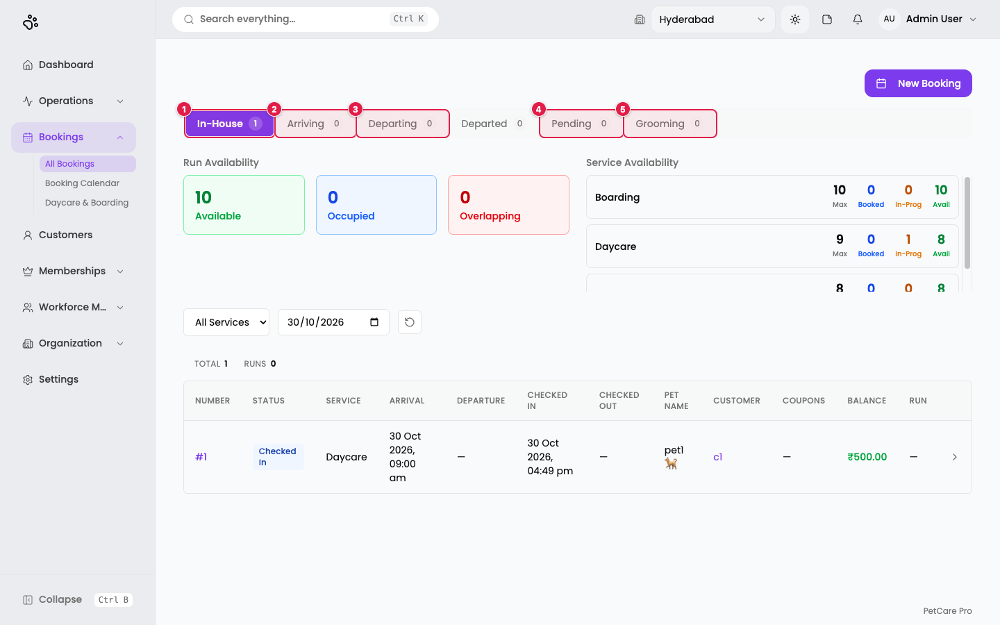
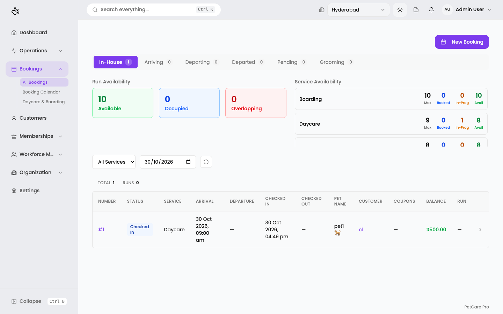
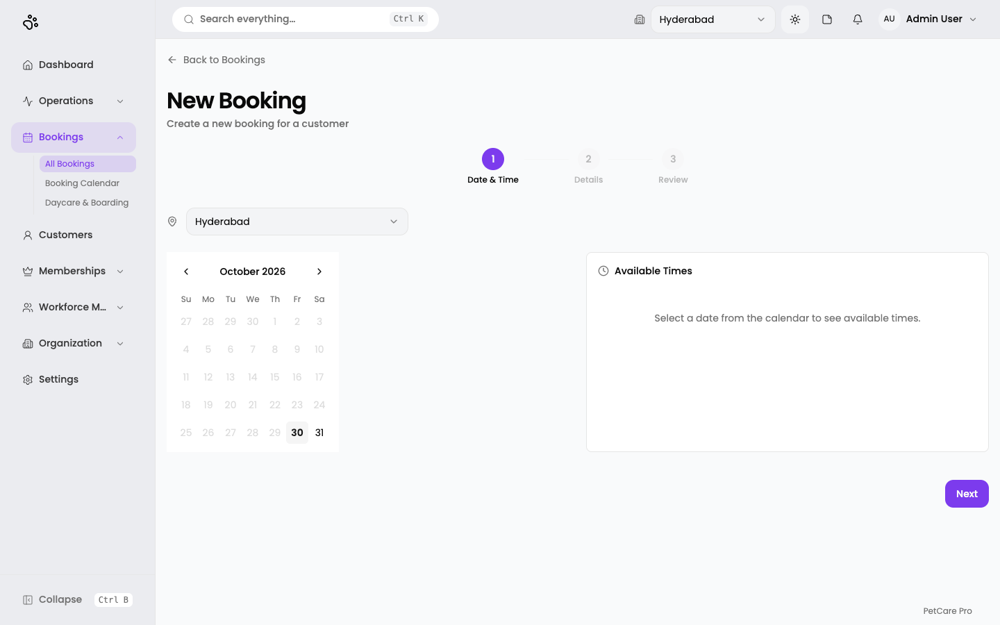
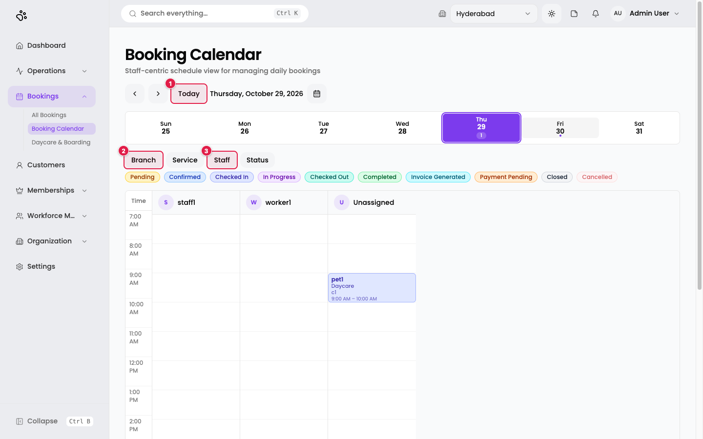
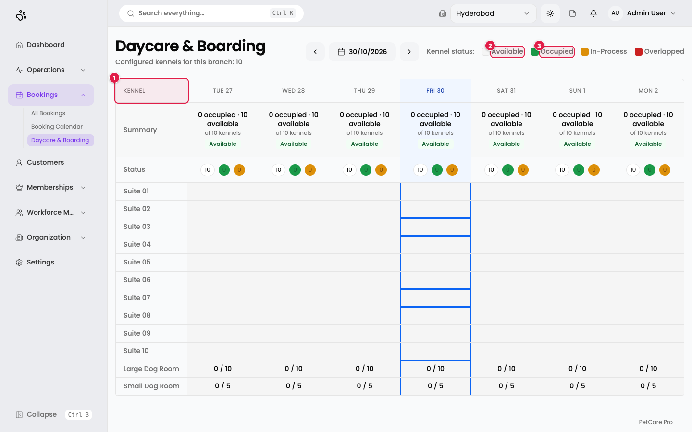

# 9. Bookings, calendar, and daycare & boarding

**Where:** Bookings → **All Bookings**, **Booking Calendar**, **Daycare & Boarding**

A booking ties a customer's pet to a service, a branch, and a time. Before booking, you need a [service](02-services.md) assigned to a [branch](03-branches.md) with capacity above zero, plus a [customer and pet](08-customers-pets.md).

## All Bookings

**Route:** `/en/t/doggyville/bookings`

1. **In-House**: pets currently checked in.
2. **Arriving**: arriving on the chosen date.
3. **Departing**: due to leave on the chosen date.
4. **Pending**: not yet confirmed.
5. **Grooming**: grooming bookings.

There is also a **Departed** tab. Each tab shows a count. The page opens on **In-House**.

Under the tabs:

- **Run Availability** cards: *Available*, *Occupied*, *Overlapping* kennel runs (here 10 / 0 / 0).
- **Service Availability**: one row per service with **Max, Booked, In-Prog, Avail** (for example Boarding 10 / 0 / 0 / 10).
- **Filters:** a service drop-down (*All Services*), a date box, and a reset button.
- The table summary shows **TOTAL** and **RUNS**.

Table columns: **NUMBER, STATUS, SERVICE, ARRIVAL, DEPARTURE, CHECKED IN, CHECKED OUT, PET NAME, CUSTOMER, COUPONS, BALANCE, RUN**, and a final arrow that opens the booking.

**New Booking** (top right) starts the booking wizard.

### Booking statuses

A booking moves through: **Pending → Confirmed → Checked in → In progress → Checked out → Completed → Invoice generated → Payment pending → Closed**, or **Cancelled** at any point it is still allowed.

Check-out is blocked while the booking still has started, unfinished tasks. A message titled *"Open tasks must be closed first"* tells you to close them on the Dispatch Board ([Tasks & operations](10-tasks-operations.md)). Tasks that were never started are cancelled automatically at check-out.

## Create a booking

Click **New Booking**, or go to `/en/t/doggyville/bookings/new`. The page is titled *New Booking: Create a new booking for a customer*, with three steps: **Date & Time → Details → Review**. You can click a finished step to go back.

### Step 1: Date & Time

1. Choose the **branch** at the top (here *Hyderabad*).
2. Pick a day on the **calendar**. Past days are greyed out.
3. The **Available Times** panel then lists time slots. A slot that has reached its service capacity is unavailable.
4. Click **Next**.

### Step 2: Details

*Described from the application's code; not captured.* Fields:

| Field | Required | Notes |
|-------|----------|-------|
| **Customer** | Yes | Pick one. **Quick Add Customer** creates one on the spot. |
| **Pet** | Yes | Lists the chosen customer's pets. **Quick Add Pet** creates one. |
| **Service** | Yes | Only services available at that branch and date are listed. |
| **Branch** | Yes | |
| **Amount (INR)** | No | Fills in from the service's default price, or the branch price. |
| **Staff member** | No | |
| **Notes** | No | Up to 1,000 characters. |

For **Boarding**, a kennel picker (a numbered kennel or a named area) appears. If every space is full, an **Overcommit a space** tick box lets you assign an occupied space anyway.

Error messages: *"Customer is required"*, *"Pet is required"*, *"Service is required"*, *"Branch is required"*.

### Step 3: Review

The review shows two cards, **Date & Time** and **Booking Details**, each with an **Edit** button. A **coupon** box (*Enter coupon code*, **Apply**) and a Subtotal and Total sit below. Click **Confirm Booking**. You see *Booking created successfully*, or *"Booking created — kennel not assigned"* if the kennel could not be saved (assign it afterwards).

## Booking Calendar

**Route:** `/en/t/doggyville/booking-calendar`

A day view with one column per staff member, plus an **Unassigned** column.

1. **Today**: jump to today. The arrows on its left step one day back or forward; the calendar icon opens a date picker.
2. **Branch** filter.
3. **Staff** filter.

There is also a **Service** and a **Status** filter, a week strip at the top (a dot marks days with bookings), and a colour legend: Pending, Confirmed, Checked In, In Progress, Checked Out, Completed, Invoice Generated, Payment Pending, Closed, Cancelled.

A booking is a coloured block at its time (here *pet1 · Daycare · c1, 9:00 AM – 10:00 AM* in the Unassigned column). Hover it to see customer, pet, service, branch, time, status, and amount. Click an **empty slot** to open *New Booking* with the date, time, and staff already filled in.

## Daycare & Boarding (kennel runs)

**Route:** `/en/t/doggyville/kennel-runs`

A week grid of your kennels for the selected branch. The subtitle reads *Configured kennels for this branch: 10*.

1. **Kennel**: one row per kennel (Suite 01 to Suite 10), then your named areas (*Large Dog Room 0/10*, *Small Dog Room 0/5*).
2. **Available**: kennel status legend.
3. **Occupied**: the others are *In-Process* and *Overlapped*.

Use the arrows and the date button to move through days. The **Summary** row for each day reads *"N occupied · N available of N kennels"* with a label of *Available*, *Filling up*, or *Full*. The *Status* row shows small counters. The column for today is highlighted. The legend also marks check-in, check-out, overnight, daycare, and overlap warning icons.

## Running a booking (service execution)

Each booking has its own execution screen, reached from the booking's **Execute** action (there is no sidebar link). The screen depends on the service category:

- **Boarding:** cards for *Boarding Details, Check In* (optional kennel number), *Log Activity* (Feeding, Walking, Cleaning, Medication), *Upload Media*, *Check Out*, and a *Timeline*.
- **Grooming:** *Start session*, a **Before** photo or video and an **After** photo or video, then *Complete session*. Both pictures are required to complete it.
- Other categories (dog park, pool, training, vet) have their own screens; not documented here.

*Described from the application's code; not captured.*

## Cancelling

On the bookings list, a row action **Cancel** cancels the booking with the note *"Cancelled by admin"*. You see *Booking cancelled*.

## Known quirk

The older in-page **Create Booking** dialog (title *Create Booking — Step N of 3*) labels the amount field in dollars, `Amount ($)`. Amounts everywhere else are in ₹.
