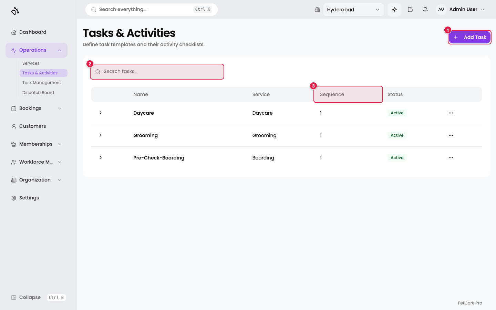
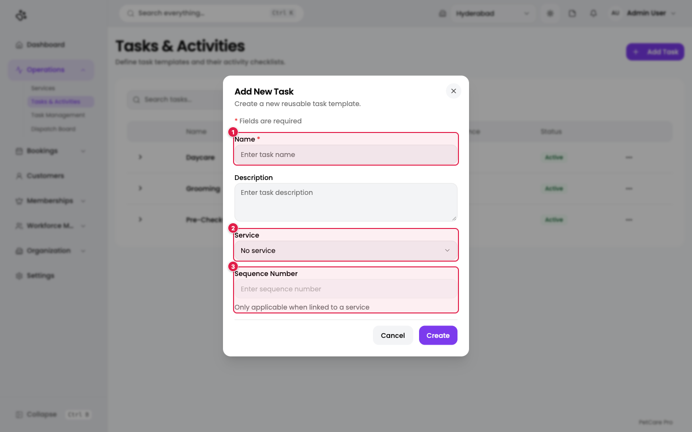
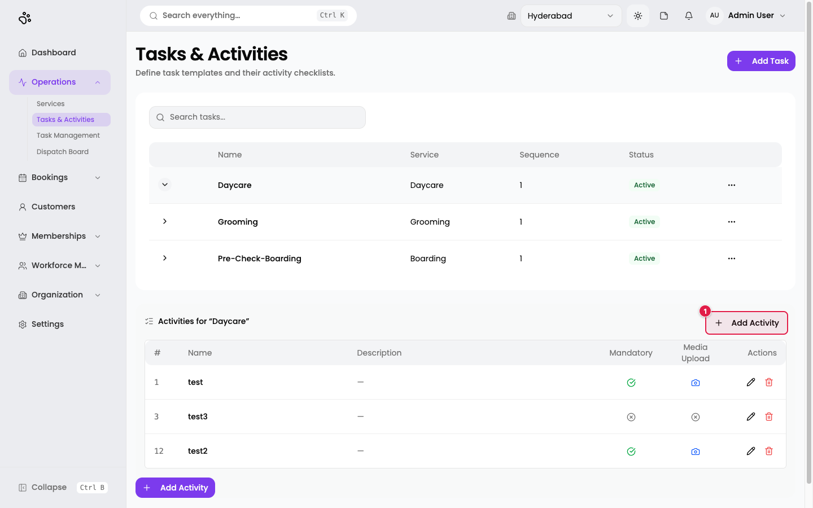
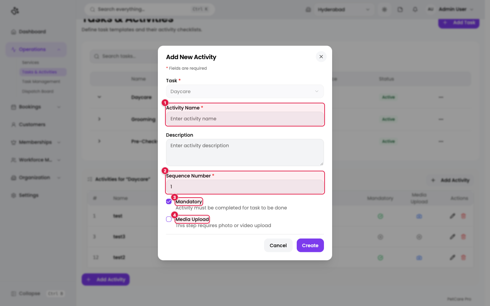
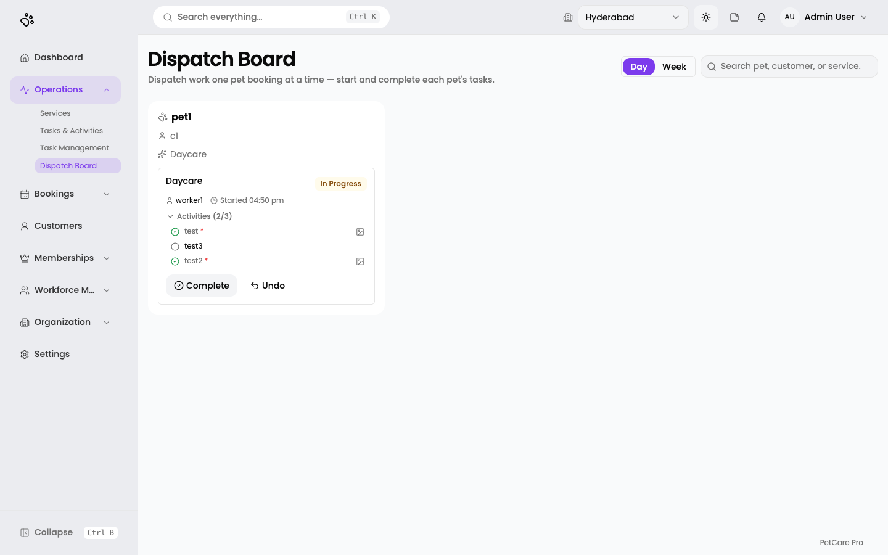

# 10. Tasks, activities, and the dispatch board

**Where:** Operations → **Tasks & Activities**, **Dispatch Board**, and (when switched on) **Task Management**

A **task template** describes a piece of work for a service (for example "Pre-Check-Boarding"). Each task has an ordered checklist of **activities**. When a booking is made, its tasks are created from these templates and handed out to staff.

## Tasks & Activities (templates)

**Route:** `/en/t/doggyville/tasks`

1. **Add Task**: create a template.
2. **Search tasks...**
3. **Sequence**: the order in which a service's tasks run (1 first).

Columns: (expand arrow), Name, Service, Sequence, Status. Each row has a ⋯ menu. DoggyVille has *Daycare*, *Grooming*, and *Pre-Check-Boarding* tasks.

### Add a task

| # | Field | Required | Notes |
|---|-------|----------|-------|
| 1 | **Name** | Yes | |
| | **Description** | No | |
| 2 | **Service** | No | Link the task to a service, or choose *No service*. Inactive services are marked *(Inactive)*. |
| 3 | **Sequence Number** | No | Only used when a service is chosen. Must be unique for that service: *"Sequence number is already in use for this service."* |

### Activities (the checklist)

Click a row's arrow to open its activities.

1. **Add Activity**: add a checklist step.

The table shows **#** (sequence), **Name**, **Description**, **Mandatory** (a tick if required), **Media Upload** (a camera if a photo or video is needed), and **Actions** (edit, delete).

| # | Field | Required | Notes |
|---|-------|----------|-------|
| 1 | **Activity Name** | Yes | |
| | **Description** | No | |
| 2 | **Sequence Number** | Yes | Unique within the task. |
| 3 | **Mandatory** | No | *"Activity must be completed for task to be done."* |
| 4 | **Media Upload** | No | *"This step requires photo or video upload."* |

Deleting an activity removes its completion records too, so be careful with activities that have history.

## Dispatch Board

**Route:** `/en/t/doggyville/task-management/board`

The Dispatch Board is where staff run the day's work, one pet booking at a time.

The page title is **Dispatch Board** with the subtitle *"Dispatch work one pet booking at a time — start and complete each pet's tasks."*

- **Day / Week** switch the time range, and the search box finds a pet, customer, or service.
- Each **card** is a pet booking (here *pet1 · c1 · Daycare*), with its current task, the employee on it (*worker1*), the start time, and the **Activities** checklist (2 of 3 done). A red `*` marks mandatory activities and a picture icon marks those that need media.
- **Complete** finishes the task and **Undo** reverses the last step.
- To **start** a task you pick an available employee. Only employees mapped to that service on the [Assignments tab](05-employees.md#the-assignments-tab-map-employees-to-services), and not already at their parallel-task limit, are offered. If none qualify, the Start button is disabled.
- **Split booking into tasks** lets you choose which of a booking's tasks to create, and whether they run in sequence.

*The Start dialog, Split dialog, and lanes are described from the application's code and were not open in the screenshot.*

## Task Management

**Route:** `/en/t/doggyville/task-management`

This is a separate worker view with **My Tasks** (or **All Tasks** for admins and managers) and **Open Tasks** tabs, where staff claim unassigned work, submit finished tasks for approval, and managers approve or reject them. It appears in the sidebar only while the **Task Management** flag is on ([Feature flags](14-settings.md#feature-flags)). It is on for DoggyVille.

Task statuses: **Assigned → Pending approval → Approved** or **Rejected**.

*Described from the application's code; not captured.*

## Checklist

- [ ] Every service you sell has its tasks defined, with unique sequence numbers
- [ ] Mandatory and media-required activities are marked
- [ ] Every employee is mapped to the services they work on ([Employees](05-employees.md))
