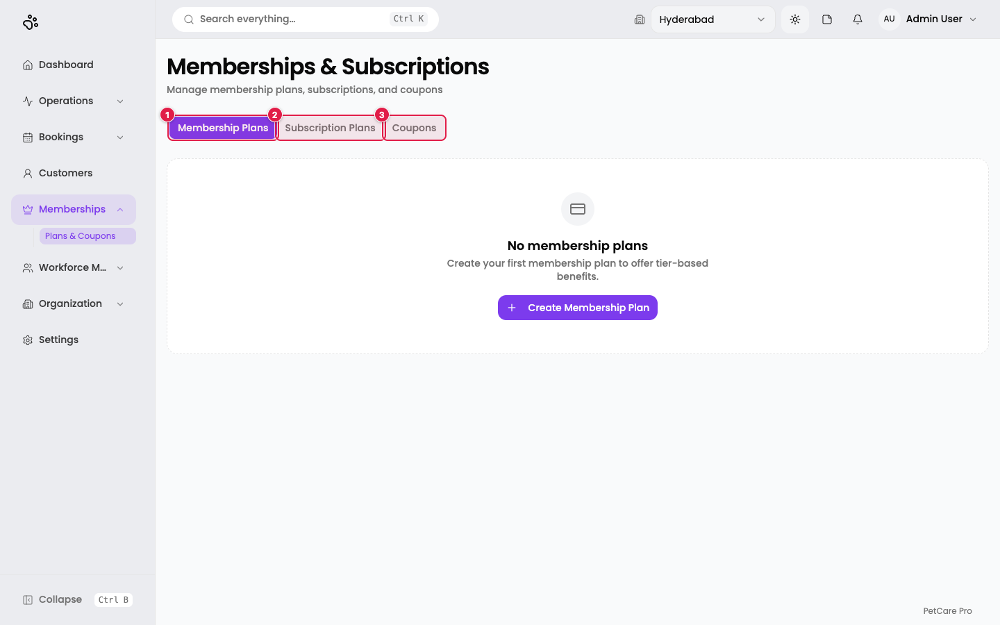
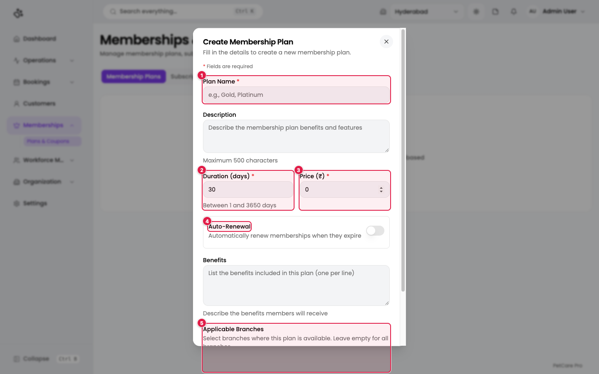
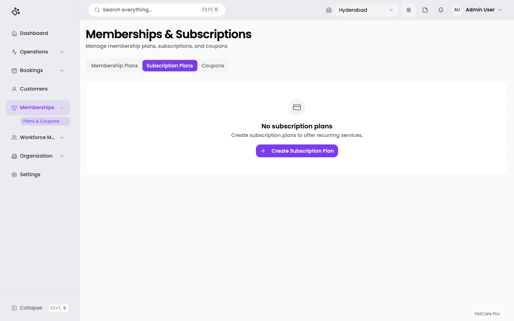
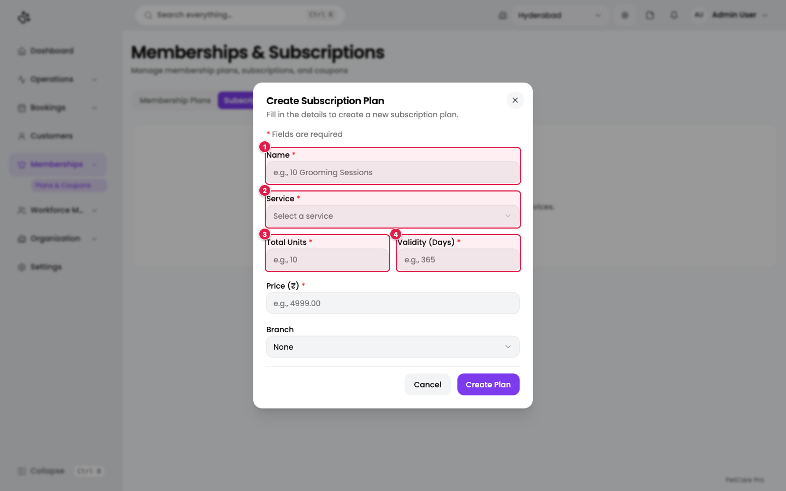
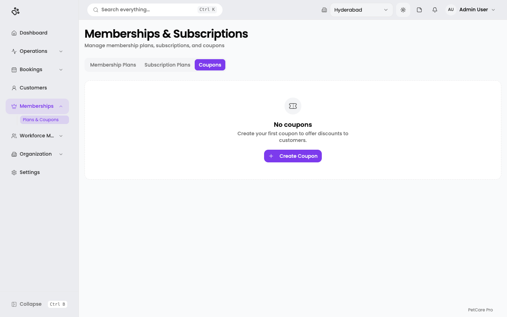
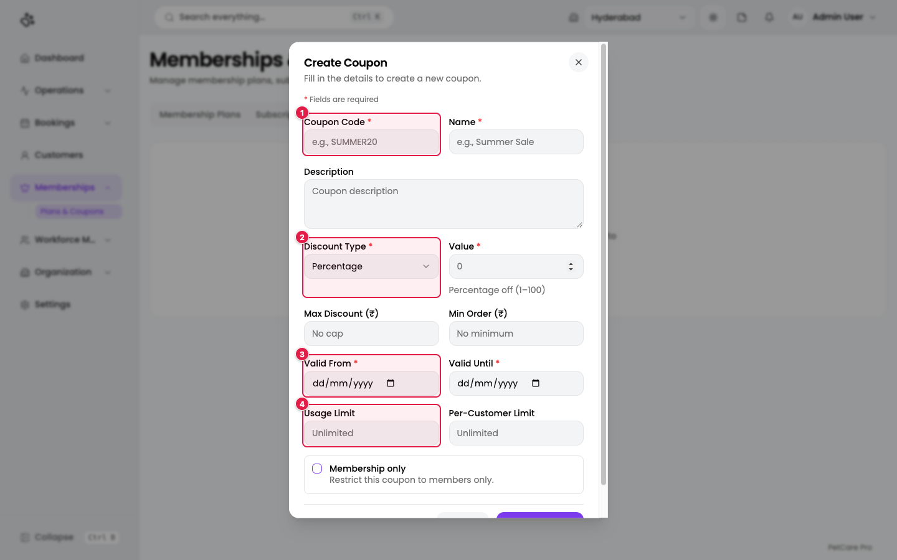

# 12. Memberships, subscriptions, and coupons

**Where:** Memberships → **Plans & Coupons** (`/en/t/doggyville/memberships`)

One page, three tabs, for ways to reward and retain customers. The last tab you used is remembered.

The tabs are **Membership Plans**, **Subscription Plans**, and **Coupons**.

| Tab | Use it for |
|-----|-----------|
| **Membership Plans** | Tiered, time-limited memberships (for example Gold) with discount rules. |
| **Subscription Plans** | A pack of sessions of one service (for example 10 grooming sessions). |
| **Coupons** | Discount codes customers enter on a booking. |

DoggyVille has none of these yet, so each tab shows an empty state with a button to create the first one.

## Membership plans

Click **Create Membership Plan**.

| # | Field | Required | Notes |
|---|-------|----------|-------|
| 1 | **Plan Name** | Yes | For example `Gold` or `Platinum`. |
| | **Description** | No | Up to 500 characters. |
| 2 | **Duration (days)** | Yes | Between 1 and 3650. Defaults to 30. |
| 3 | **Price (₹)** | Yes | |
| 4 | **Auto-Renewal** | No | A switch: renew automatically when the membership expires. |
| | **Benefits** | No | One benefit per line. |
| 5 | **Applicable Branches** | No | Leave empty to make the plan available at all branches. |
| | **Status** | No | Active or Inactive. |

Save with **Create Plan** (it reads **Update Plan** when editing). The table then shows Name, Duration, Price, Auto-Renewal, Enrollments, and Status. Use the row's **Edit** action to change a plan.

**Discount rules:** each plan has a *Discount Rules* dialog ("Maximum 20 rules per plan"). A rule has a type (**Percentage** or **Flat (₹)**) and applies to **All, Service, or Product**. Save with **Save Rules**.

*The discount-rules dialog is described from the application's code.*

### Enrolling a customer

From a customer's **Memberships** tab ([Customers](08-customers-pets.md)), choose a plan in the **Enroll in Membership Plan** dialog and click **Enroll**.

## Subscription plans

Click the **Subscription Plans** tab.

Click **Create Subscription Plan**.

| # | Field | Required | Limits |
|---|-------|----------|--------|
| 1 | **Name** | Yes | Up to 100 characters. Example: `10 Grooming Sessions`. |
| 2 | **Service** | Yes | The service the sessions apply to. |
| 3 | **Total Units** | Yes | Whole number, 1 to 9,999. |
| 4 | **Validity (Days)** | Yes | Whole number, 1 to 3,650. |
| | **Price (₹)** | Yes | 0.01 to 9,999,999.99. |
| | **Branch** | No | Defaults to *None* (all branches). |

The table lists Name, Service, Total Units (shown as "N sessions"), Validity, Price, Active Subscriptions, and Status. Assign one to a customer with **Assign Subscription Plan** on their page.

## Coupons

Click the **Coupons** tab.

Click **Create Coupon**.

| # | Field | Required | Notes |
|---|-------|----------|-------|
| 1 | **Coupon Code** | Yes | What the customer types, for example `SUMMER20`. |
| | **Name** | Yes | Internal name. |
| | **Description** | No | |
| 2 | **Discount Type** | Yes | **Percentage** or **Flat Amount**. |
| | **Value** | Yes | *Percentage off (1–100)* or the flat amount in ₹. |
| | **Max Discount (₹)** | No | Cap for percentage coupons. Blank means *No cap*. |
| | **Min Order (₹)** | No | Blank means *No minimum*. |
| 3 | **Valid From** | Yes | |
| | **Valid Until** | Yes | |
| 4 | **Usage Limit** | No | Total uses. Blank means *Unlimited*. |
| | **Per-Customer Limit** | No | Blank means *Unlimited*. |
| | **Membership only** | No | Restrict the coupon to members. |

The table shows Code, Type, Value, Usage, Valid Until, and Status. Each coupon has **Edit** and an **Activate/Deactivate** action. Customers apply a coupon on the review step of a booking ([Bookings](09-bookings.md)).
