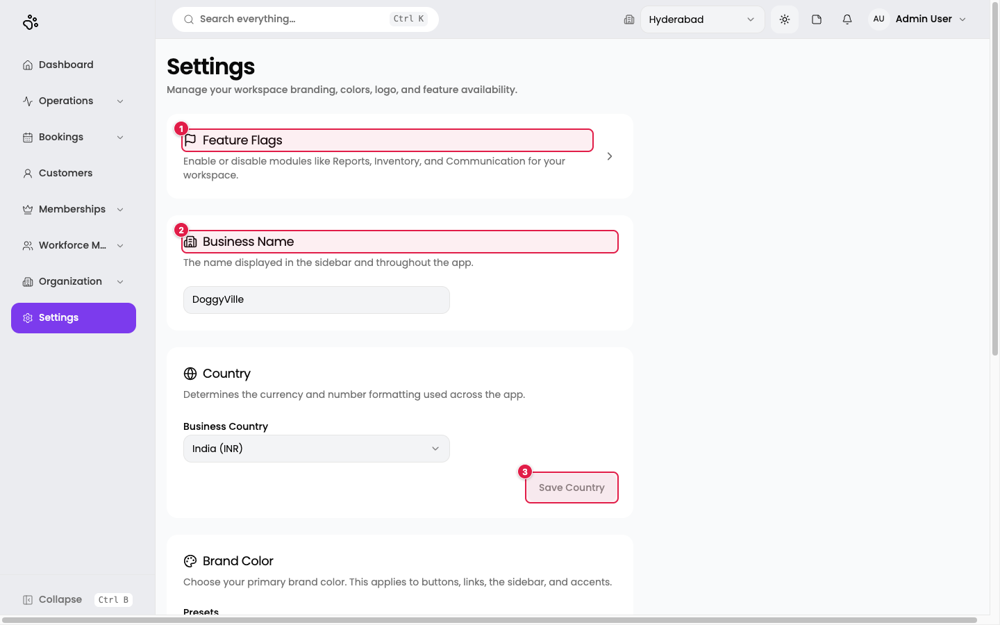
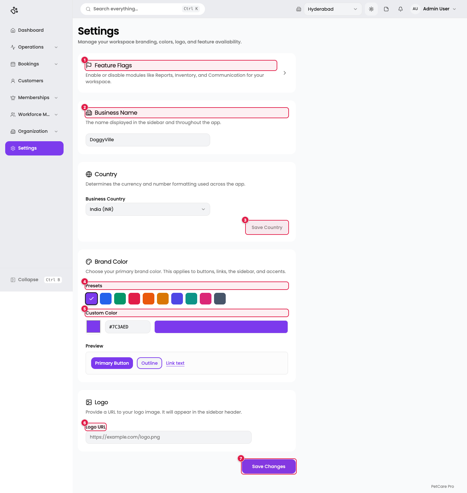
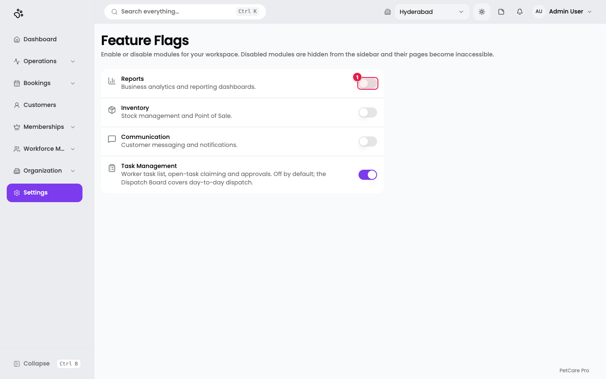
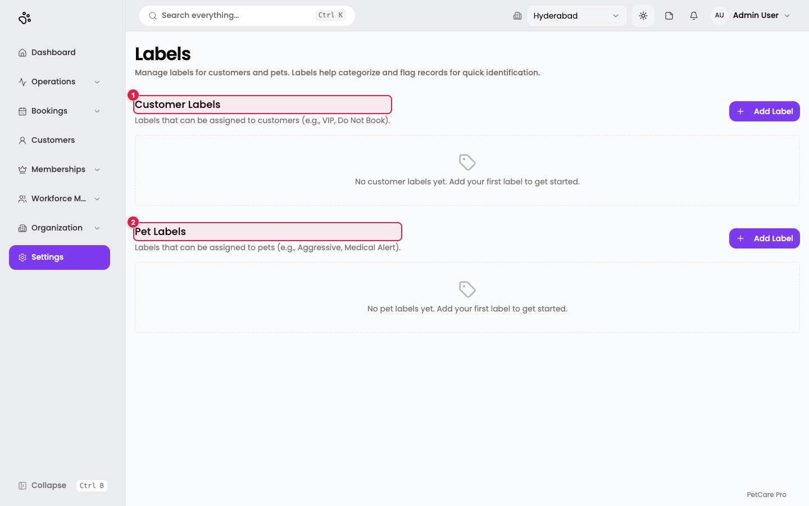
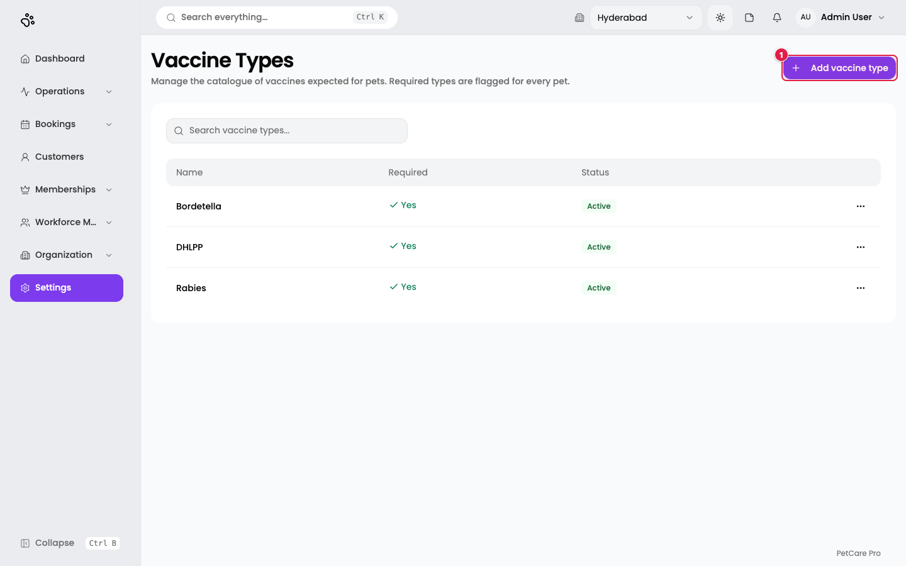

# 14. Settings, feature flags, labels, vaccine types

**Where:** **Settings** (`/en/t/doggyville/settings`)

Settings holds workspace-wide choices. Like Branches and Roles, it needs permission to **edit the Organization module**; other users are sent to the Dashboard.

1. **Feature Flags**: a link to the page that switches modules on or off.
2. **Business Name**: the name shown in the sidebar and across the app. Here, *DoggyVille*.
3. **Save Country**: the country has its own save button.

The whole page, top to bottom:

1. **Feature Flags**
2. **Business Name**
3. **Save Country**: *Business Country* sets the currency and number format (here *India (INR)*). The button is disabled until you change the country.
4. **Presets**: ten brand colours (purple, blue, emerald, rose, orange, amber, indigo, teal, pink, slate). The ticked swatch is the current one.
5. **Custom Color**: a colour picker plus a hex code box (here `#7C3AED`) for any other colour. The **Preview** below shows a *Primary Button*, an *Outline* button, and *Link text* in the chosen colour.
6. **Logo URL**: a web address for your logo image, for example `https://example.com/logo.png`. A preview appears once it is set.
7. **Save Changes**: saves the business name, colour, and logo. You see *Settings saved successfully*.

The brand colour applies to buttons, links, the sidebar, and accents.

## Feature flags

**Where:** Settings → **Feature Flags** (`/en/t/doggyville/settings/feature-flags`)

1. **Switch**: turn a module on or off. A disabled module is hidden from the sidebar and its pages stop working.

| Module | What it switches | State in DoggyVille |
|--------|------------------|---------------------|
| **Reports** | Business analytics and reporting dashboards | Off |
| **Inventory** | Stock management and Point of Sale | Off |
| **Communication** | Customer messaging and notifications | Off |
| **Task Management** | Worker task list, open-task claiming, and approvals. Off by default; the Dispatch Board covers day-to-day dispatch. | On |

Each switch saves immediately and shows a message such as *"Reports enabled."* If saving fails, the switch jumps back.

## Labels

**Where:** `/en/t/doggyville/settings/labels`

1. **Customer Labels**: tags for customers, for example *VIP* or *Do Not Book*.
2. **Pet Labels**: tags for pets, for example *Aggressive* or *Medical Alert*.

Each section has an **Add Label** button. A label is an **emoji** (paste one) and a **name** of up to 50 characters. Labels can be edited or deleted; deleting a label removes it from every customer or pet that has it. Once created, labels are assigned from the customer or pet page (**Add Labels**) and show in the customer list.

DoggyVille has no labels yet, so both sections show an empty state.

> The Labels and Vaccine Types pages are not linked from the Settings page. Open them by their addresses, or ask your administrator to add menu links.

## Vaccine types

**Where:** `/en/t/doggyville/settings/vaccine-types`

1. **Add vaccine type**: opens a dialog.

DoggyVille already has three vaccine types, all required and active: **Bordetella, DHLPP, and Rabies**. Each row has a ⋯ menu.

Columns: Name, Required, Status. Search: *Search vaccine types...*. The dialog has a **Name** (for example `Rabies`, up to 100 characters) and a **Required** tick box: *"Pets are expected to have this vaccine."* Required types are flagged on every pet. **Deactivating** a type stops it being offered for new vaccination records but leaves existing records alone.
