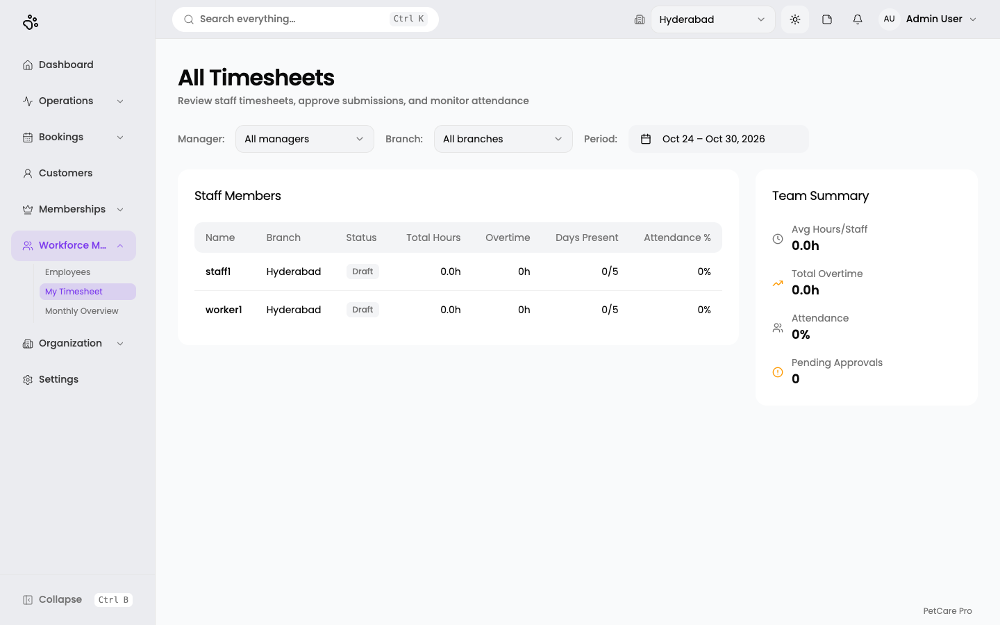

# 15. Timesheets

**Where:** Workforce Management → timesheet pages

Employees log their hours; managers approve them. Which sidebar entries you see depends on your sign-in role:

| Role | Entries |
|------|---------|
| Employee | My Timesheet · Monthly Overview |
| Manager | My Timesheet · Monthly Overview · Team Timesheet |
| Admin | Timesheet (the team view) |

> In the screenshots, the admin account's sidebar shows **My Timesheet** and **Monthly Overview**, which does not match this table. Opening `/timesheet` as that admin still redirects to the team view. Treat the table as the intended behaviour and report the sidebar difference to your developer.

## Team / All Timesheets (managers and admins)

**Route:** `/en/t/doggyville/timesheet/team`

The title is **All Timesheets** (or **Team Timesheets** when viewed by manager): *"Review staff timesheets, approve submissions, and monitor attendance."*

- **Manager:** filter by reporting manager (*All managers*).
- **Branch:** filter by branch (*All branches*).
- **Period:** a date-range button (here *Oct 24 – Oct 30, 2026*) with presets: Last 1 week, Last 2 weeks, Last month, Last 3 months, or pick dates (future dates are disabled).

The **Staff Members** table shows, per person: **Name, Branch, Status** (Draft, Submitted, Approved, or *No period*), **Total Hours, Overtime, Days Present** (out of 5), and **Attendance %**. Click a row to see that person's detail, and click again to close it.

The **Team Summary** panel shows **Avg Hours/Staff, Total Overtime, Attendance,** and **Pending Approvals**.

### Approve or reject

Submitted timesheets appear in a **pending approvals** list with **Approve** and **Reject**. Rejecting requires a reason (*"Provide a reason for rejection..."*), then **Confirm Rejection**. You see *Timesheet approved* or *Timesheet rejected*. The employee sees *"Returned for revision"* with your reason.

### Mark leave

A manager can mark a staff member as on leave for a date: **Mark Leave**, choose the **Staff Member** and **Date**, then confirm. *The dialog is described from the code; the screen that opens it was not found.*

## My Timesheet (employees and managers)

**Route:** `/en/t/doggyville/timesheet`

*Described from the application's code; not captured, because the admin account is redirected away from it.*

- Title: *My Timesheet: Log your working hours, track attendance, and submit for approval.*
- A week selector, a weekly grid of your entries, a **Week Summary** (Total Regular Hours, Overtime Hours, Days Present, Days Absent, Days Late, Days On Leave), and a **Timesheet Status** card.
- **Add Entry** (shown while the week is a draft) opens **Add Time Entry**:

| Field | Required | Notes |
|-------|----------|-------|
| **Date** | Yes | Locked when editing. |
| **Clock In** / **Clock Out** | Yes | 24-hour times. |
| **Break (minutes)** | No | Defaults to 0. |
| **Branch** | No | Shown only if you work at more than one branch. |
| **Note (optional)** | No | Up to 500 characters. |

- When the week is complete, click **Submit for Approval**. The status moves **Draft → Submitted → Approved**, or **Returned for revision** with the manager's reason, after which you edit and resubmit.

## Monthly Overview

**Route:** `/en/t/doggyville/timesheet/monthly`

A month summary with the same six totals and a weekly table: **Week, Total Hours, Overtime, Days Present, Status**. Admins opening this page are redirected to the team view, so it was not captured.
